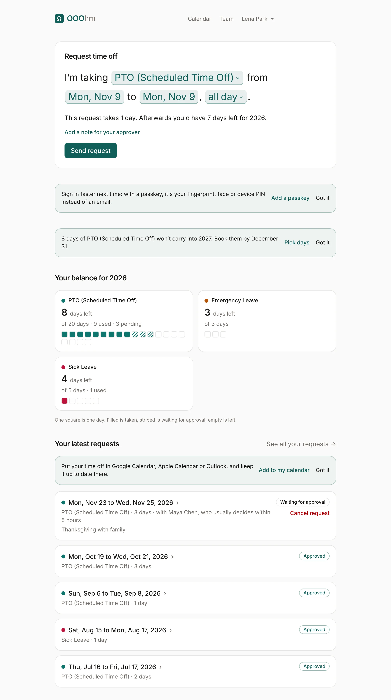

# OOOhm guide

OOOhm (Out Of Office, Holiday Manager) is a calm leave tracker for small teams. People ask for time
off, their approver says yes or no, and everyone can see who's out. This guide walks through every
screen and every setting, and shows every email OOOhm sends.

The screenshots come from a demo company, Northwind Studio, with made-up people. They show the
default Classic theme in light mode. Your company may look different: an admin picks the theme
(see [Appearance](admin-appearance.md)).

## Who sees what

OOOhm has three roles. An admin sets each person's role under Admin → People.

| Role | What they can do |
| --- | --- |
| Employee | Ask for time off, see their balance, see colleagues on the calendar (as the company allows). |
| Manager | Everything an employee can, plus an **Approvals** inbox for the people who report to them, and **Reports** for their team. |
| Admin | Everything a manager can, plus the **Admin** area: people, departments, leave types, holidays, company settings, appearance, emails, the audit log and integrations. |

## For everyone

- [Getting started](getting-started.md): signing in, passkeys, your account, light or dark.
- [Asking for time off](asking-for-time-off.md): Home, the request sentence or form, your balance, your requests, cancelling.
- [Calendar](calendar.md): month and year views, whose time off you see, asking by dragging across days, calendar subscriptions.
- [Who's out](team.md): the team list and each person's page.

## For managers

- [Approvals](approvals.md): the inbox, coverage warnings, approving from the email.
- [Reports](reports.md): time off by month, type, department and person.

## For admins

- [People](admin-people.md): inviting, editing, allowances, CSV import, deactivating and deleting.
- [Departments, levels and leave types](admin-organization.md): department managers, coverage limits, allowance rules, carryover.
- [Holidays](admin-holidays.md): single days and runs of days like an end-of-year shutdown.
- [Company settings](admin-company.md): working days, time zone, approval, who sees whose time off.
- [Appearance](admin-appearance.md): logo, theme, accent color, corners, request style, layout.
- [Emails](emails.md): every email OOOhm sends, who gets it and when, and how to change its words.
- [Audit log and integrations](admin-audit-integrations.md): every change on record, webhooks, API keys, connectors.

For running OOOhm yourself, see [hosting](../hosting.md) and [deploy](../deploy.md). For the REST API
and webhook payloads, see the [API reference](../api.md).
