# Appearance

Admin → **Appearance** sets how OOOhm looks for everyone in the company. People can't change it for
themselves; they only choose light or dark on their [account page](getting-started.md#your-account),
where the theme has a dark version.

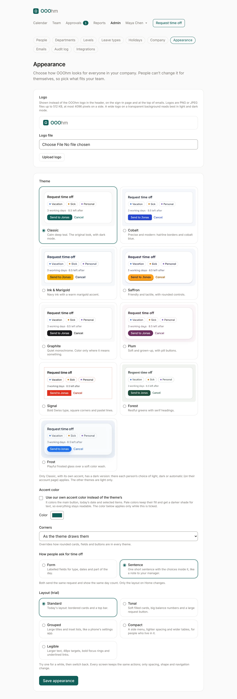

## Logo

Your logo shows instead of the OOOhm logo in the header, on the sign-in page and at the top of emails.
Logos are PNG or JPEG files up to 512 KB, at most 4096 pixels on a side. A wide logo on a transparent
background reads best in light and dark mode. **Remove logo** brings the OOOhm logo back; emails
already sent show your company's name instead.

## Theme

Nine themes, each a full look: colours, type, corners and buttons. Each option shows a small live
preview.

| Theme | Look |
| --- | --- |
| **Classic** (default) | Calm deep teal. The original look, with dark mode. |
| **Cobalt** | Precise and modern: hairline borders and cobalt blue. |
| **Ink & Marigold** | Navy ink with a warm marigold accent. |
| **Saffron** | Friendly and tactile, with rounded controls. |
| **Graphite** | Quiet monochrome. Colour only where it means something. |
| **Plum** | Soft and grown-up, with pill buttons. |
| **Signal** | Bold Swiss type, square corners and pastel lines. |
| **Forest** | Restful greens with serif headings. |
| **Frost** | Playful frosted glass over a soft colour wash. |

Only Classic, with its own accent, has a dark version. The other themes are light only.

| | | |
| --- | --- | --- |
| 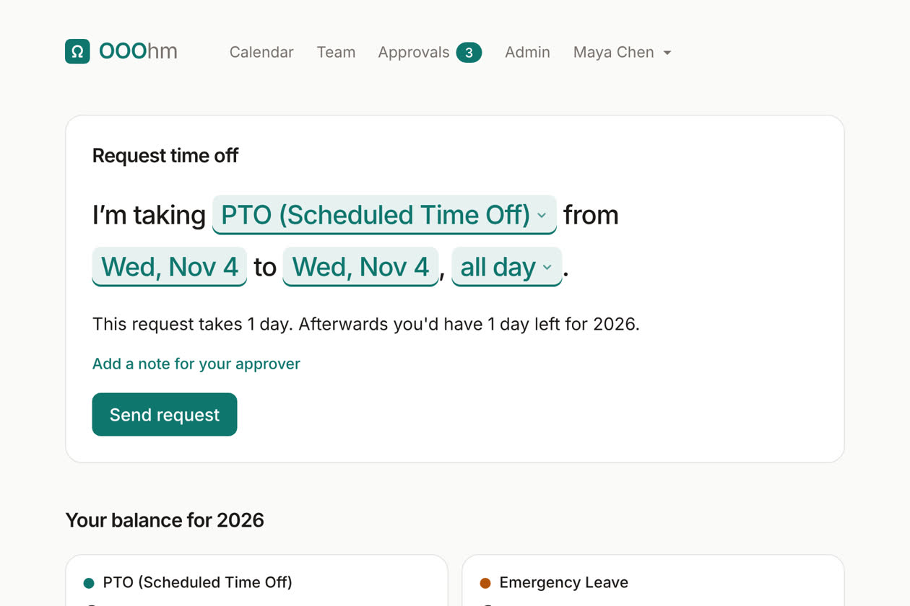 | 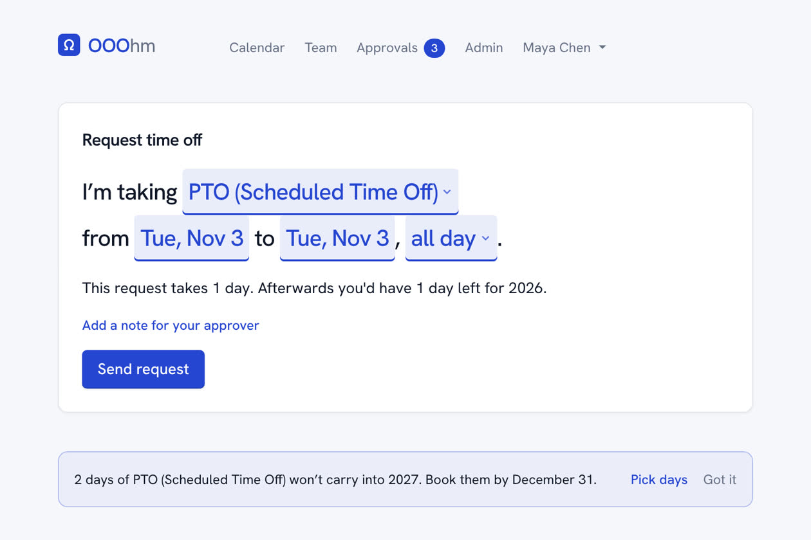 | 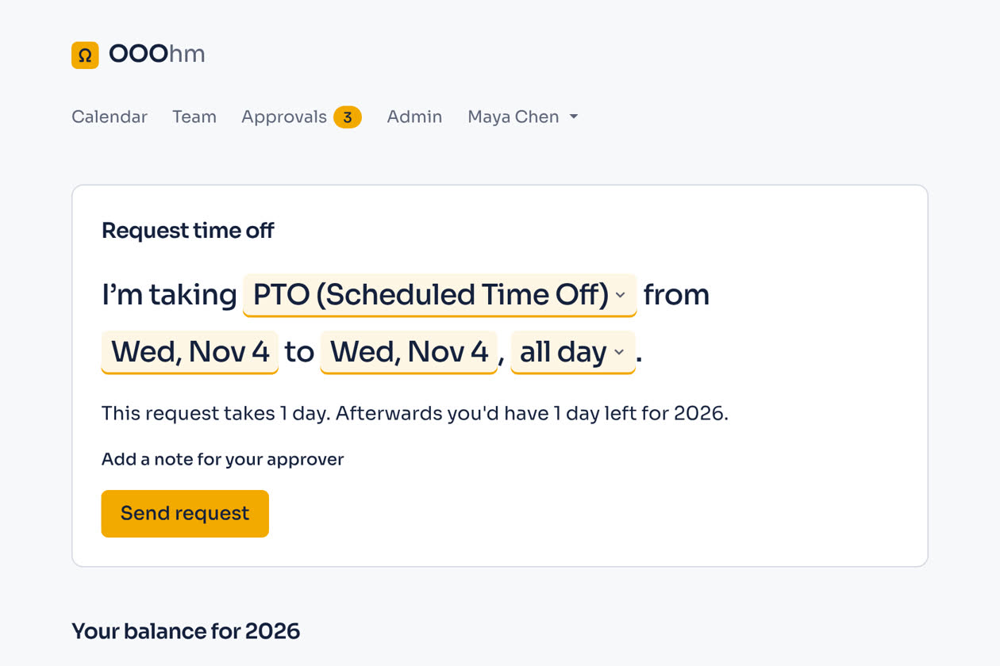 |
| 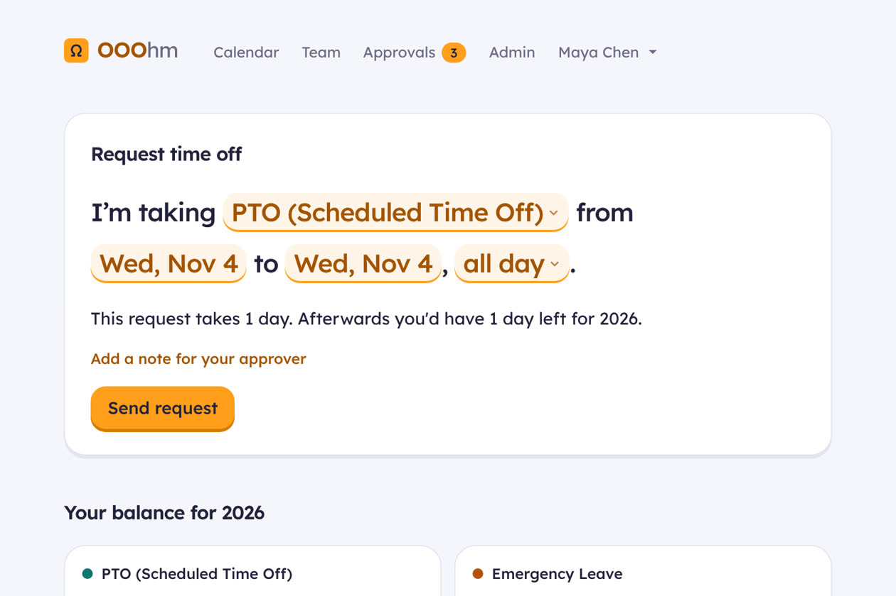 | 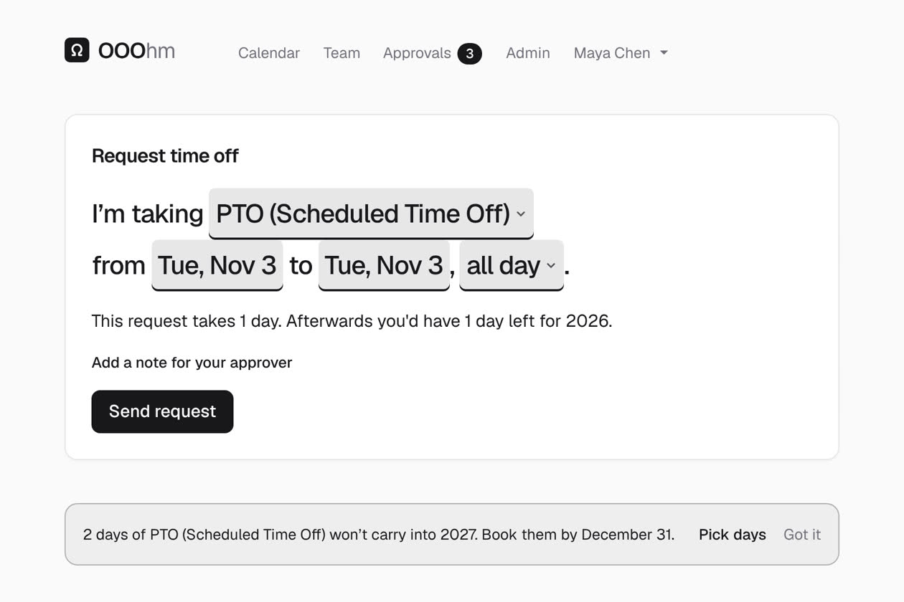 | 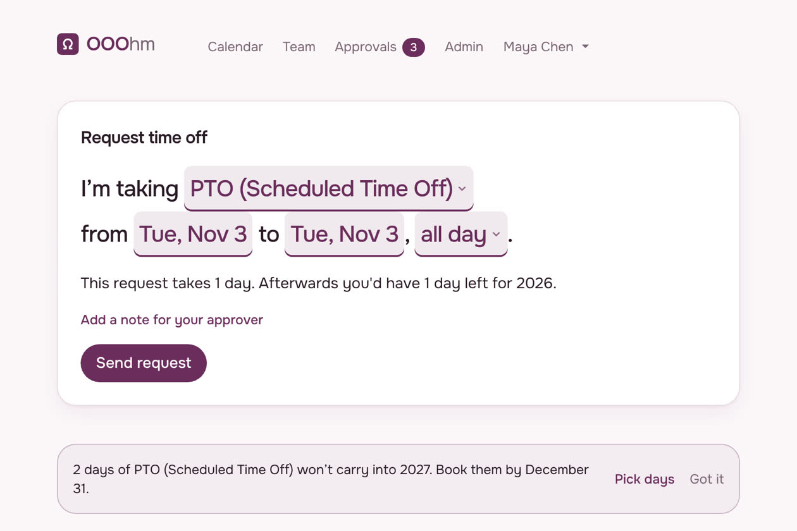 |
| 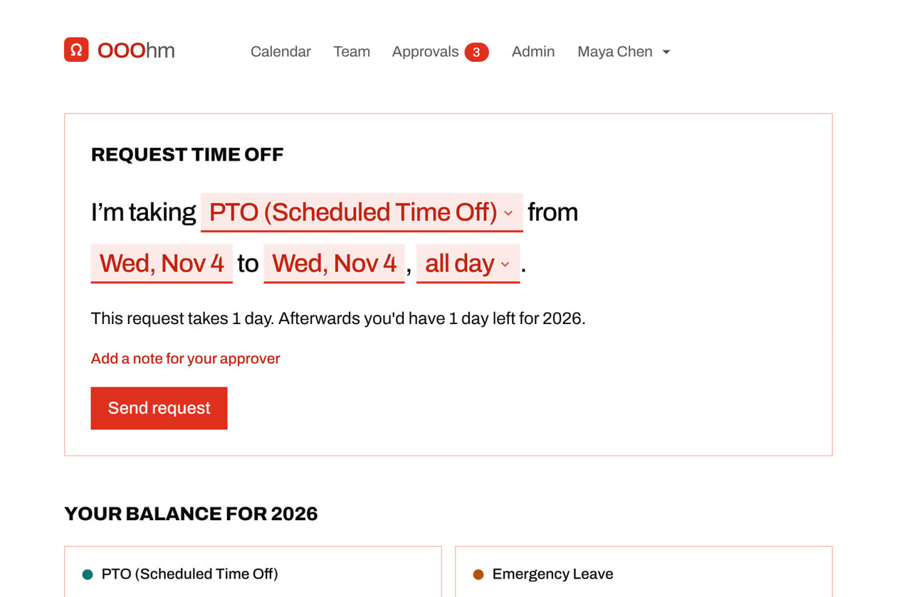 | 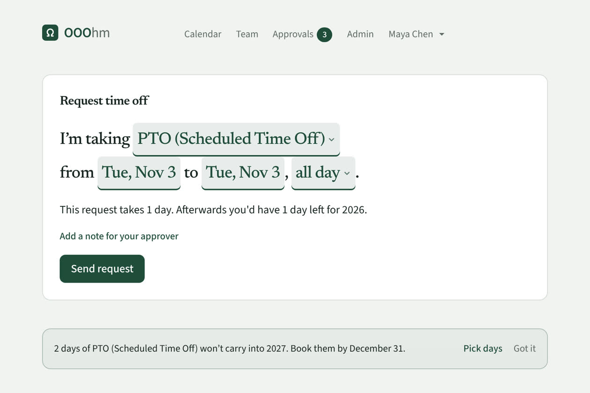 | 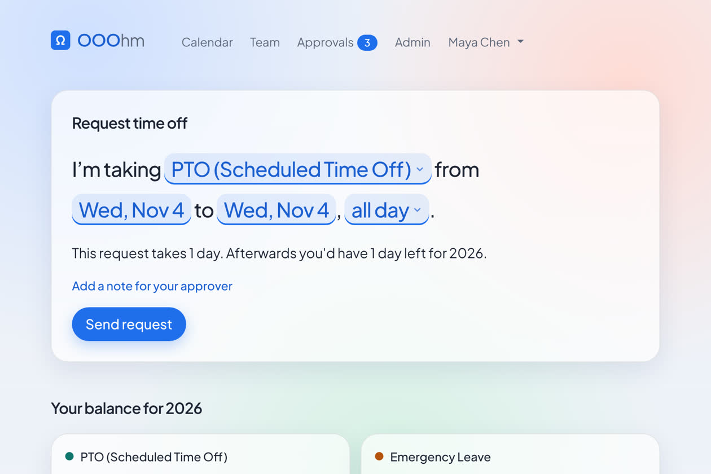 |

## Accent color

Tick **Use our own accent color instead of the theme's** and pick a colour. It colours the main button,
today's date and selected items, and the buttons and links in emails. Pale colours keep their fill and
get a darker shade for text, so everything stays readable. The colour applies only while the box is
ticked.

## Corners

**Corners** overrides how rounded cards, fields and buttons are in every theme: As the theme draws them
(default), Square, Slightly rounded, or Rounded.

## How people ask for time off

| Choice | On Home |
| --- | --- |
| **Form** | Labelled fields for type, dates and part of the day. |
| **Sentence** | One short sentence with the choices inside it, like a note to your manager. |

Both send the same request and show the same day count. Only the layout on Home changes. See
[Asking for time off](asking-for-time-off.md#the-request).

## Layout (trial)

Five layouts change spacing, shape and navigation; every screen keeps the same actions. Try one for a
while, then switch back.

| Layout | Look |
| --- | --- |
| **Standard** (default) | Bordered cards and a top bar. |
| **Tonal** | Soft filled cards, big balance numbers and a large request button. |
| **Grouped** | Large titles and inset lists, like a phone's settings app. |
| **Compact** | A side menu, tighter spacing and wider tables, for people who live in it. |
| **Legible** | Larger text, 48px targets, bold focus rings and underlined links. |

| | |
| --- | --- |
| 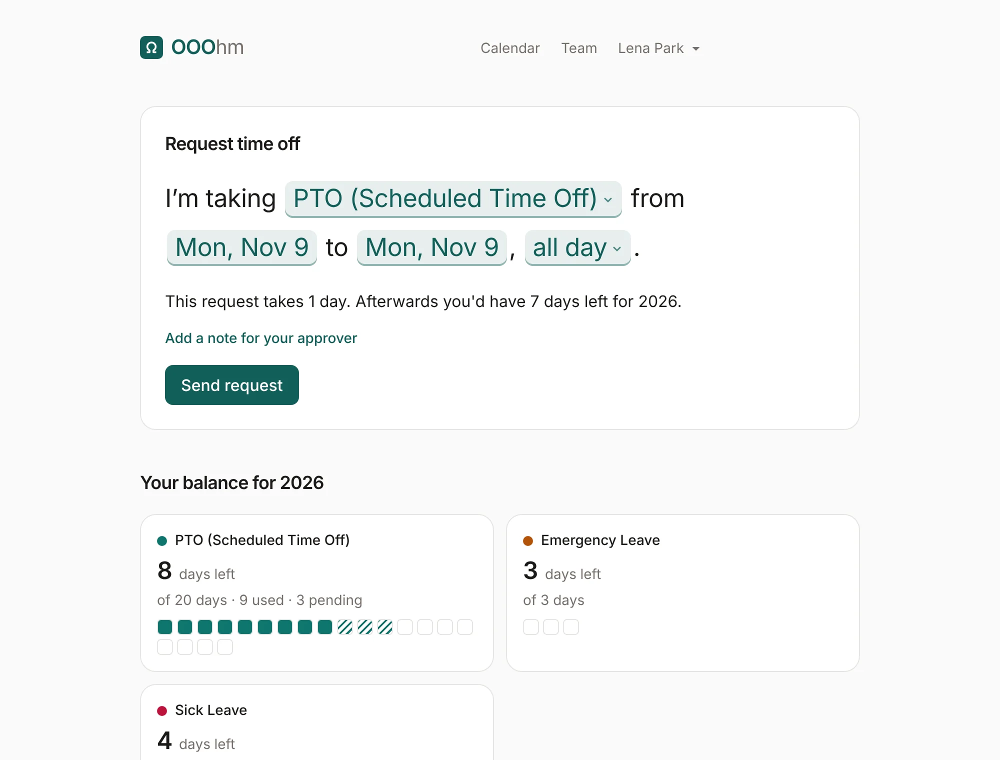 | 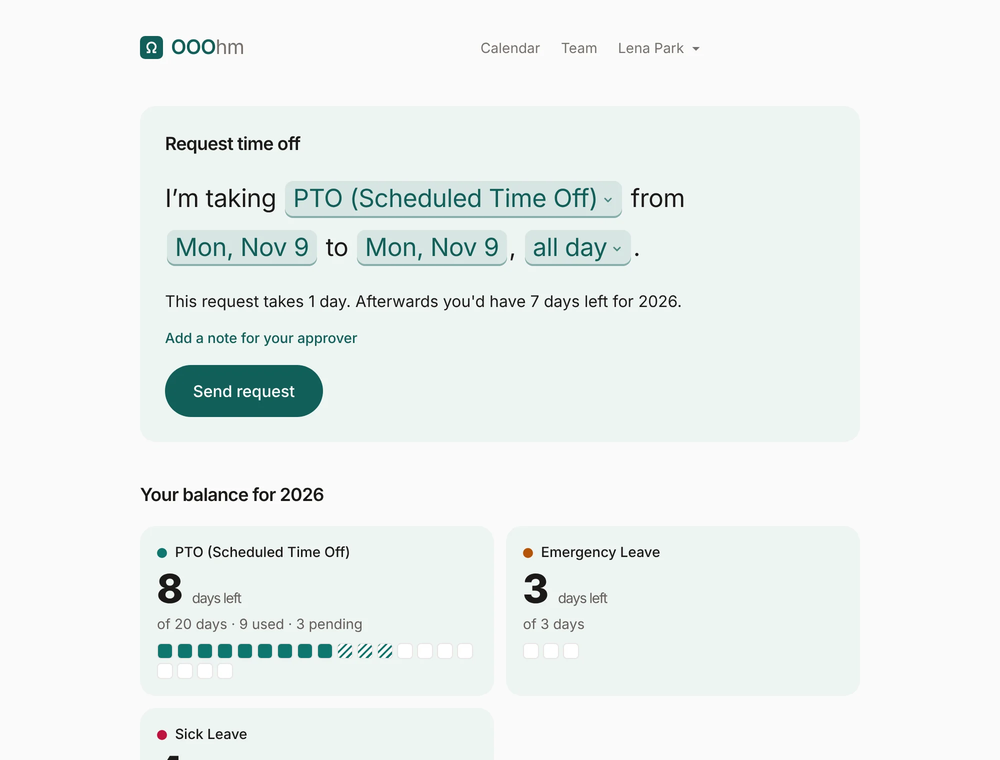 |
| 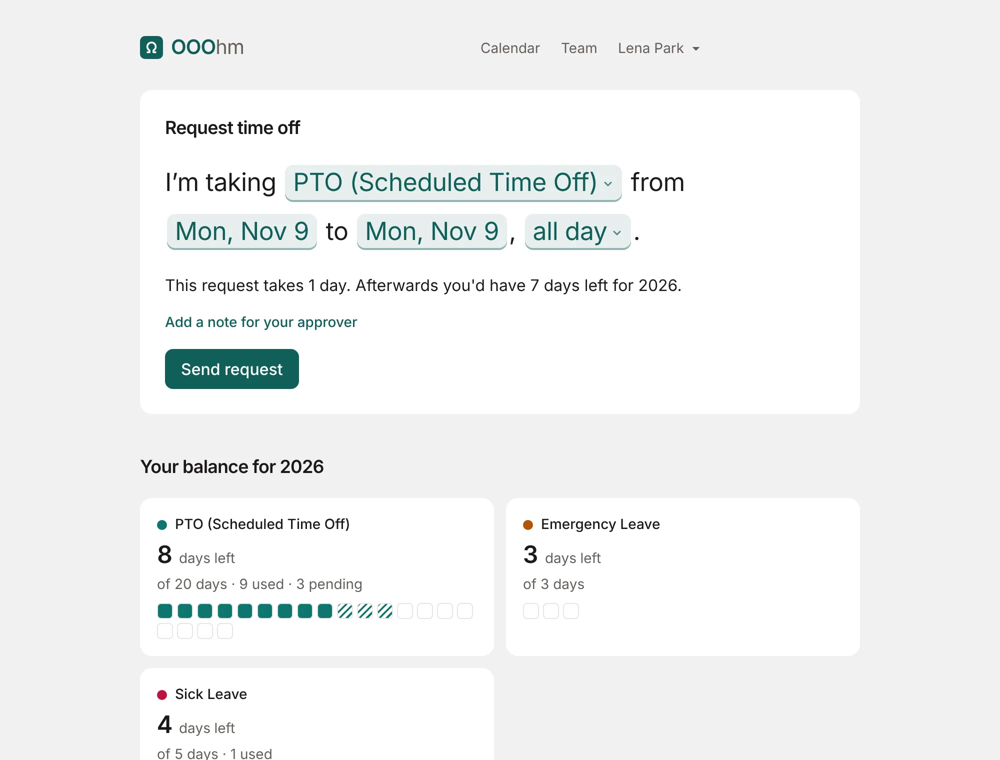 | 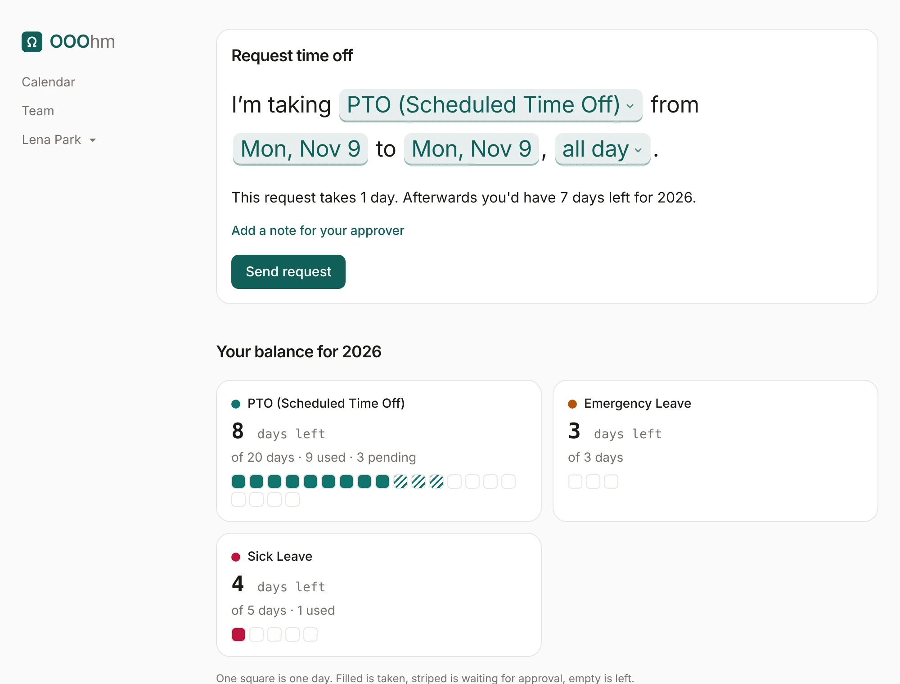 |
| 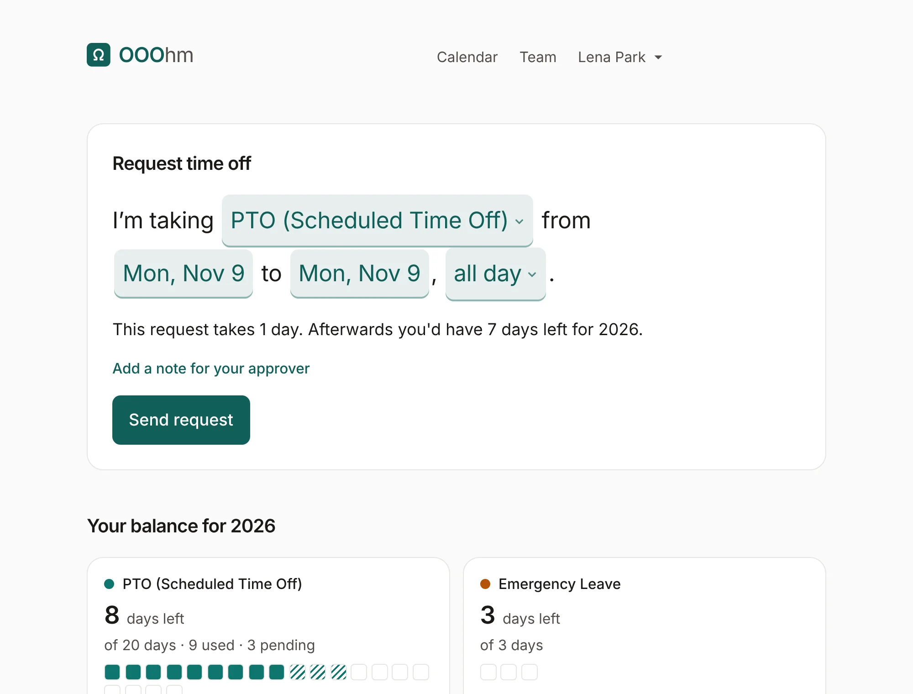 | |
