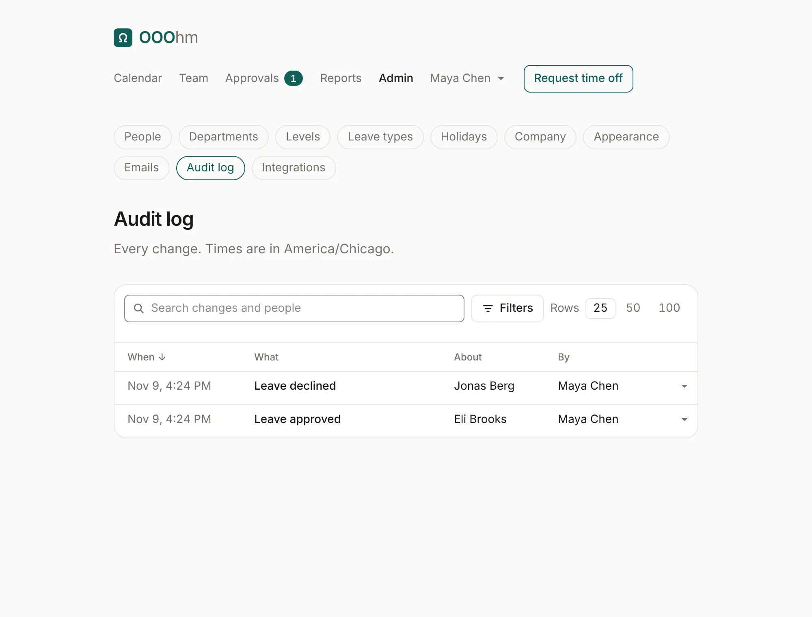
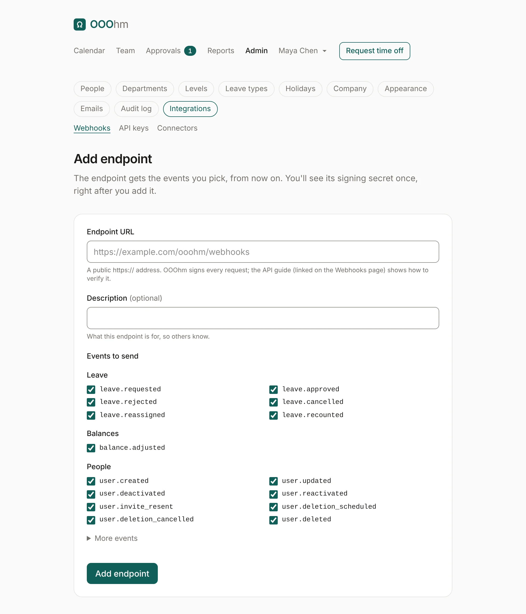
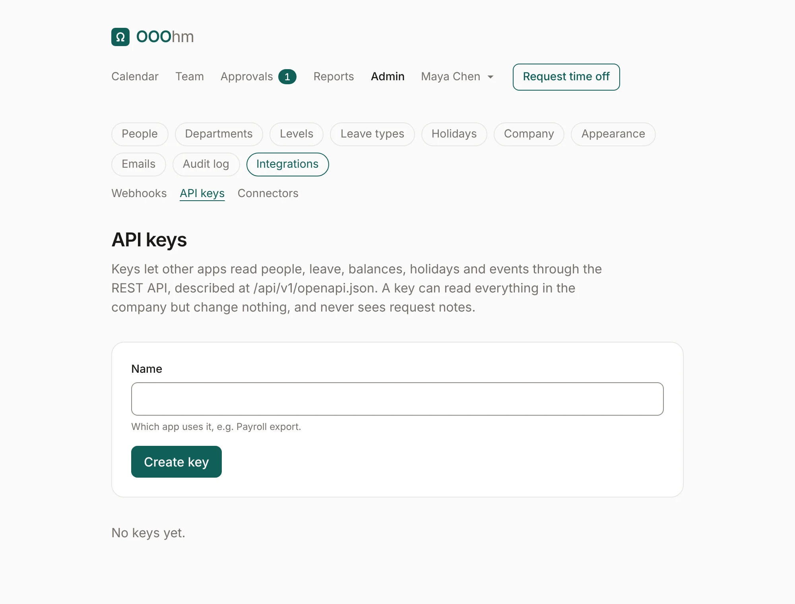
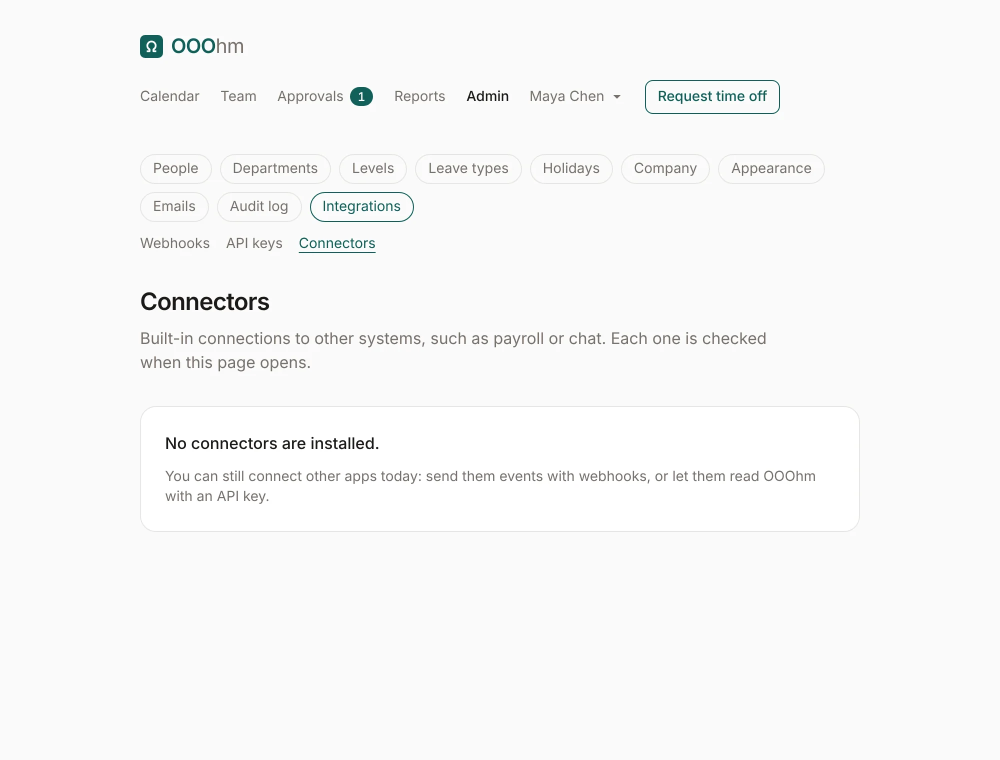

# Audit log and integrations

## Audit log

Admin → **Audit log** records every change: every request and decision, every balance change, and every
admin change, each naming who or what made it (a person, a person through a sync or an import, an API
key, or a system process like the yearly rollover). Nothing is anonymous. Times are in the company's
time zone.

Search changes and people from the box at the top. **Filters** narrows the log by **What** happened,
**Done by**, **About** whom, and a **From** and **To** date; **Rows** sets how many show per page. Click
**When** to flip between newest and oldest first, a person or an action in a row to see only those
changes, and the arrow at the end of a row to see the fields that changed.

## Integrations

Admin → **Integrations** has three tabs: Webhooks, API keys and Connectors. The
[API reference](../api.md) has every endpoint, event and payload.

### Webhooks

When something changes, OOOhm sends a signed POST to each endpoint that wants that event, and retries
for about two days if the endpoint is down. **Add endpoint** asks for:

| Field | What it does |
| --- | --- |
| **Endpoint URL** | A public https:// address. |
| **Description** | What this endpoint is for, so others know. |
| **Events to send** | Leave, Balances and People are ticked by default. **More events** adds company setup, calendar links, integrations and imports. |

An endpoint's page has **Send test event**, its recent deliveries and their status, its **Signing
secret** (with **Get a new secret**, which stops the old one at once), and **Delete**.

### API keys

Keys let other apps read people, leave, balances, holidays and events through the REST API. A key can
read everything in the company but change nothing, and never sees request notes. Give it a **Name**
(which app uses it, like *Payroll export*). The key is shown once: copy it into the app then, since
OOOhm stores only a hash. Send it as `Authorization: Bearer <key>`. **Revoke** stops it at once.

### Connectors

Built-in connections to other systems, such as payroll or chat. None ship yet; until then, use webhooks
and API keys.

