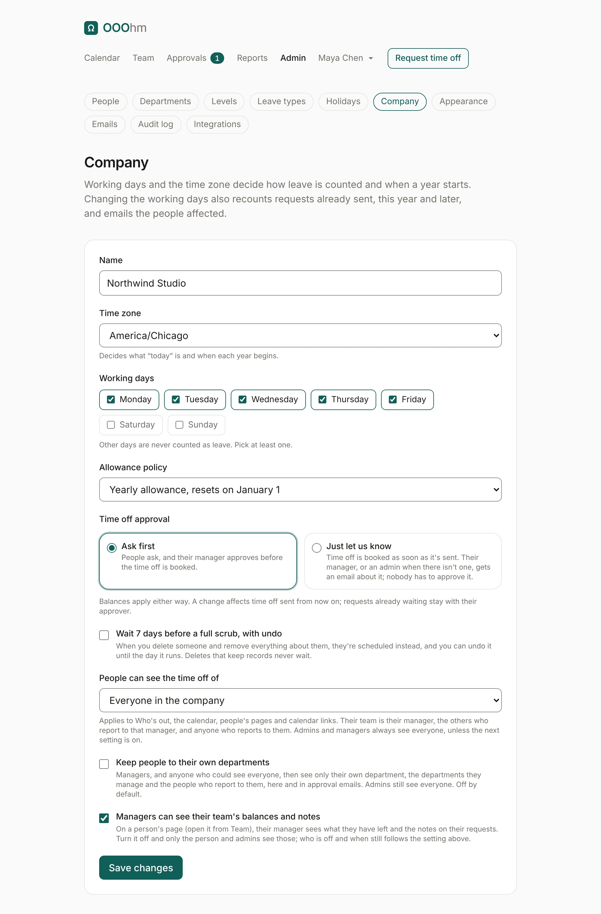

# Company settings

Admin → **Company** holds the settings that decide how time off is counted, approved and seen.
**Save changes** saves them all at once; each change is in the audit log.

| Setting | Default | What it does |
| --- | --- | --- |
| **Name** | From setup | Your company's name, as emails use it (the invite says who added you to which company). |
| **Time zone** | America/Chicago | Decides what "today" is and when each year begins. |
| **Working days** | Monday to Friday | Other days are never counted as leave. Pick at least one. Changing them recounts requests already sent, this year and later, and emails the people affected ([Recounted](emails.md#recounted)). |
| **Allowance policy** | Yearly allowance, resets on January 1 | How balances work. Each leave type has a yearly allowance that resets on January 1; [carryover](admin-organization.md#leave-types) is set per leave type. |
| **Time off approval** | Ask first | See below. |
| **Wait 7 days before a full scrub, with undo** | Off | When you delete someone and remove everything about them, they're scheduled instead, and you can undo it until the day it runs. Deletes that keep records never wait. |
| **People can see the time off of** | Everyone in the company | See below. |
| **Keep people to their own departments** | Off | See below. |
| **Managers can see their team's balances and notes** | On | On a person's page, their manager sees what they have left and the notes on their requests. Off, only the person and admins see those. |

## Time off approval

| Choice | What happens |
| --- | --- |
| **Ask first** | People ask, and their approver approves before the time off is booked. |
| **Just let us know** | Time off is booked as soon as it's sent. Their manager, or an admin when there isn't one, gets a [heads-up email](emails.md#heads-up); nobody has to approve it. The request on Home becomes **Book time off**. |

Balances apply either way. A change affects time off sent from then on; requests already waiting stay
with their approver.

## Who sees whose time off

**People can see the time off of** applies to Who's out, the calendar, people's pages and calendar
links:

| Choice | Employees see |
| --- | --- |
| **Everyone in the company** | Everyone. |
| **Their team** | Themselves, their manager, the others who report to that manager, and anyone who reports to them. |
| **Only their own** | Only themselves. The calendar's Just me, My team and Everyone pills don't show. |

Admins and managers always see everyone, unless **Keep people to their own departments** is on. Then
managers, and anyone who could see everyone, see only their own department, the departments they
manage and the people who report to them, in OOOhm and in approval emails. Admins still see everyone.
