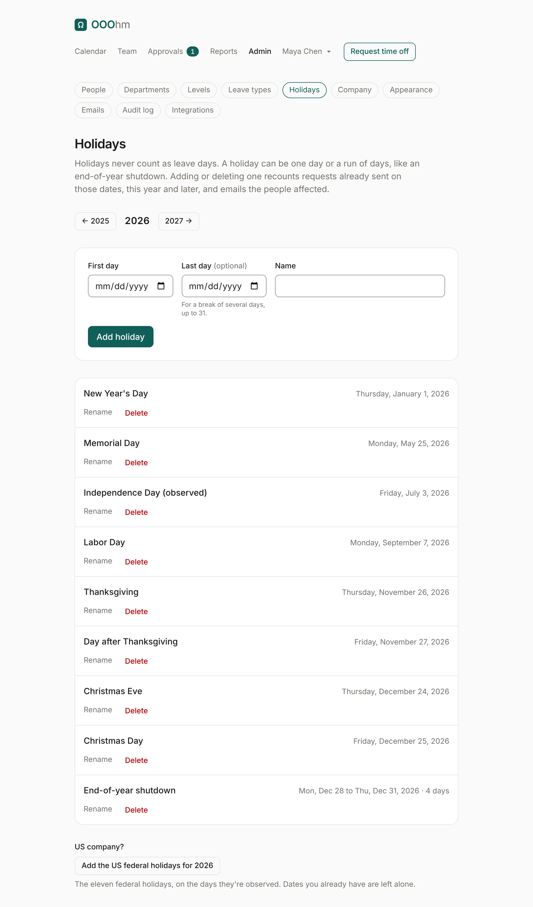
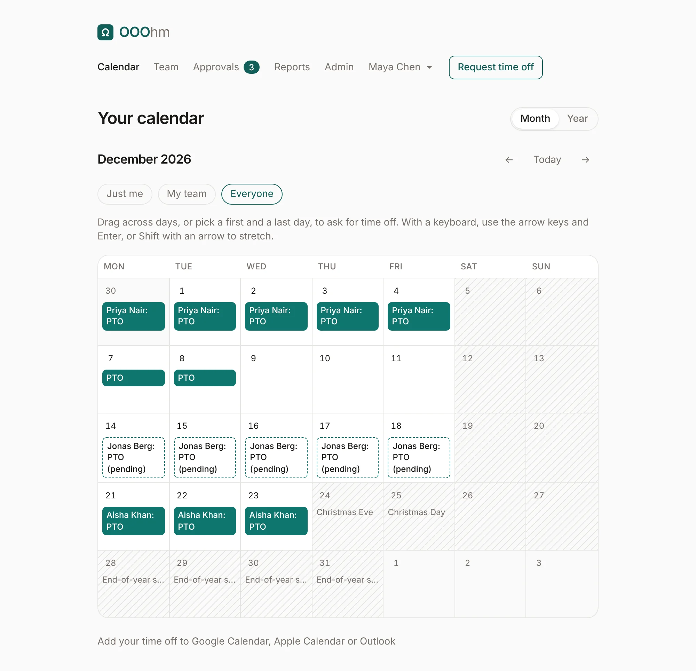

# Holidays

Admin → **Holidays** lists the company's holidays for a year; the arrows move between years. Holidays
never count as leave days, and they show on everyone's calendar.

## Adding a holiday

Give the **First day** and a **Name**, then **Add holiday**. For a break of several days, like an
end-of-year shutdown, also give a **Last day**: up to 31 days, and it may run into next year. A run of
days shows as one entry, with its dates and how many days it covers, and you rename or delete it as one.

## When holidays change

Adding or deleting a holiday recounts requests already sent on those dates, this year and later. If a
request now takes fewer (or more) days, the person's balance follows, and they get a
[Recounted email](emails.md#recounted) that says what changed. Deleting asks first, since requests on
those dates may count them as working days again.

## US company?

**Add the US federal holidays for the year** adds the eleven federal holidays, on the days they're
observed. Dates you already have are left alone.
