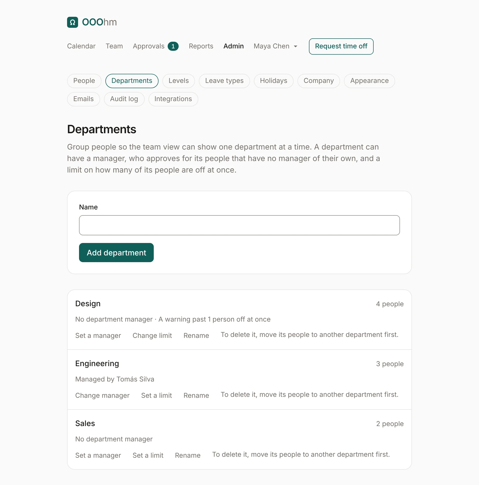
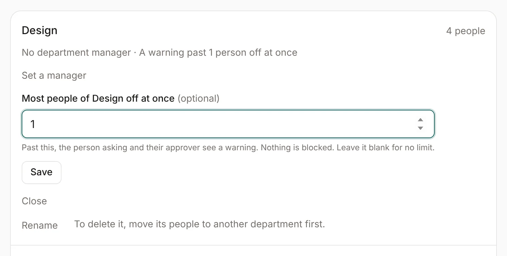
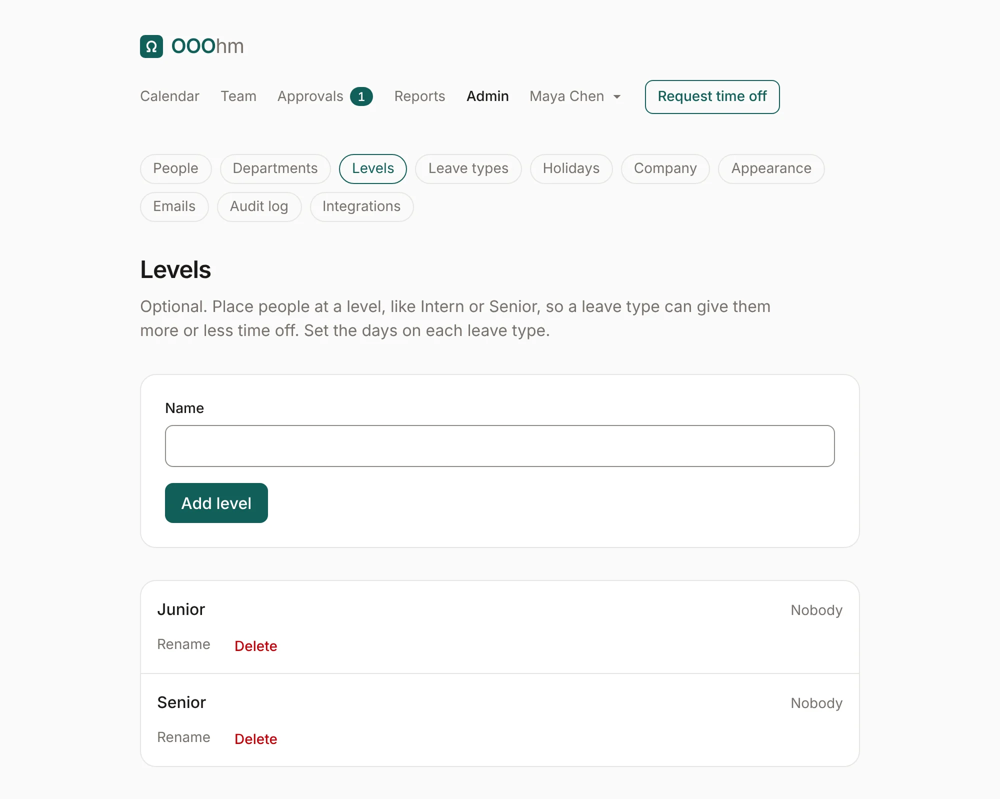
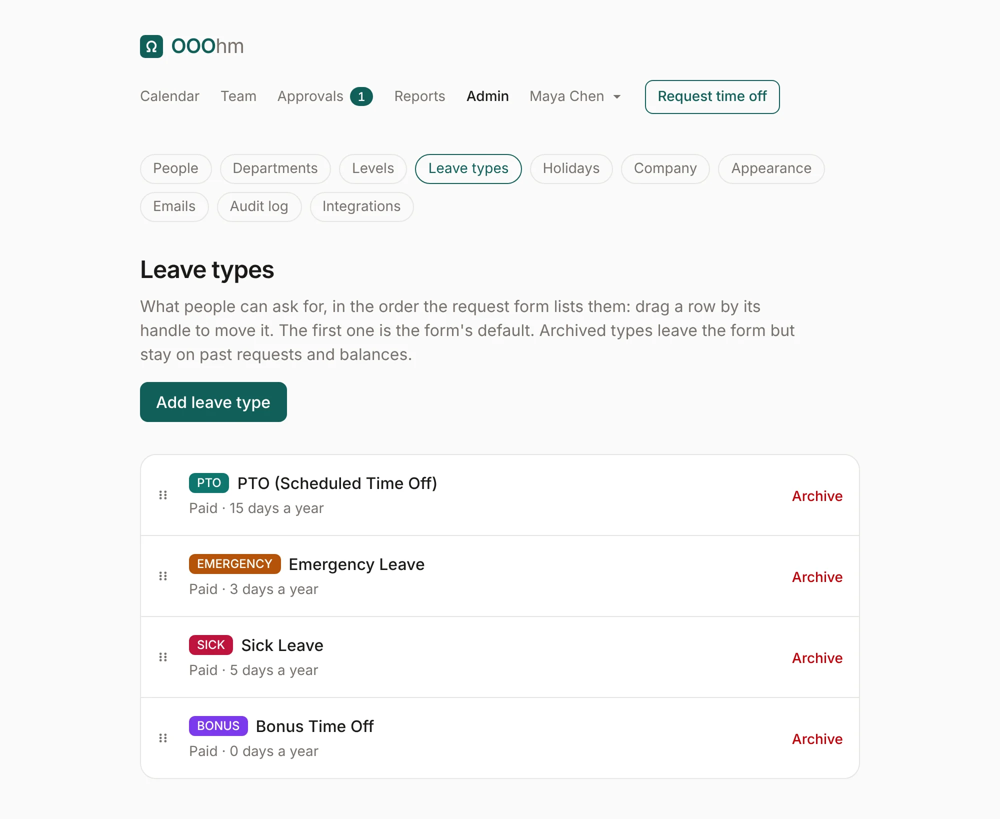
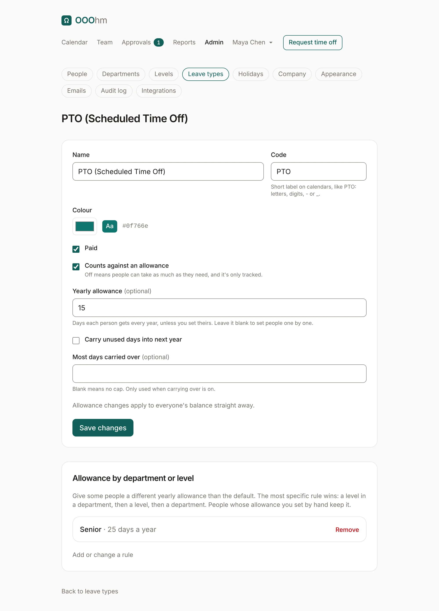

# Departments, levels and leave types

## Departments

Admin → **Departments** groups people, so Who's out, the calendar and Reports can show one department
at a time. **Add department** takes a name. Each department shows how many people are in it, its
manager and its limit.

| Setting | What it does |
| --- | --- |
| **Set a manager** | The department manager approves for people in it who have no active manager of their own. They also see those people's balances and notes like a manager, when the company lets managers see them. |
| **Set a limit** | Most people of the department off at once (see below). Blank means no limit. |
| **Rename** | Changes the name everywhere. |
| **Delete** | Only for an empty department: move its people to another department first. |

### Coverage limits

A limit is the most people of one department who should be off on the same day. Past it, the person
asking sees a warning under their request, and their approver sees it in bold in the
[approvals inbox](approvals.md#needs-you). Nothing is blocked.

### Department scoping

With **Keep people to their own departments** on (Admin → [Company](admin-company.md)), managers and
everyone else except admins only see their own department, the departments they manage, and the
people who report to them. Off by default.

## Levels

Admin → **Levels** is optional. Place people at a level, like Junior or Senior, so a leave type can give
them more or less time off. A level with nobody at it can be deleted; its allowance rules go with it.

## Leave types

Admin → **Leave types** lists what people can ask for, in the order the request lists them. Drag a row
by its handle to reorder; the first one is the request's default. Each row sums up the type: paid or
unpaid, its yearly allowance, and whether days carry over.

**Archive** takes a type off the request; past requests and balances keep it. Archived types are listed
under **Archived**, with **Restore**. **Add leave type** opens the same form as editing one:

| Setting | What it does |
| --- | --- |
| **Name** | What people see, like *PTO (Scheduled Time Off)*. |
| **Code** | A short label on calendars, like PTO: letters, digits, - or _. |
| **Colour** | Its colour on calendars, balances and reports. The *Aa* sample shows text on it stays readable. |
| **Paid** | Marks it paid or unpaid on the leave type list and in the API. |
| **Counts against an allowance** | Off means people can take as much as they need, and it's only tracked (for example, sick leave at some companies). |
| **Yearly allowance** | Days each person gets every year, unless you set theirs. Blank means you set people one by one. |
| **Carry unused days into next year** | Off by default. On, unused days move to next year when the year rolls over on January 1. |
| **Most days carried over** | A cap on carried days. Blank means no cap. Only used when carrying over is on. |

Allowance changes apply to everyone's balance straight away. Every balance change is in the audit log.

### Allowance by department or level

Under a leave type's settings, rules give some people a different yearly allowance than the default:
for example, 25 days of PTO for Senior. A rule can name a department, a level, or both.

The most specific rule wins: a level in a department, then a level, then a department. People whose
allowance you set by hand on their [allowances page](admin-people.md#allowances) keep it.
