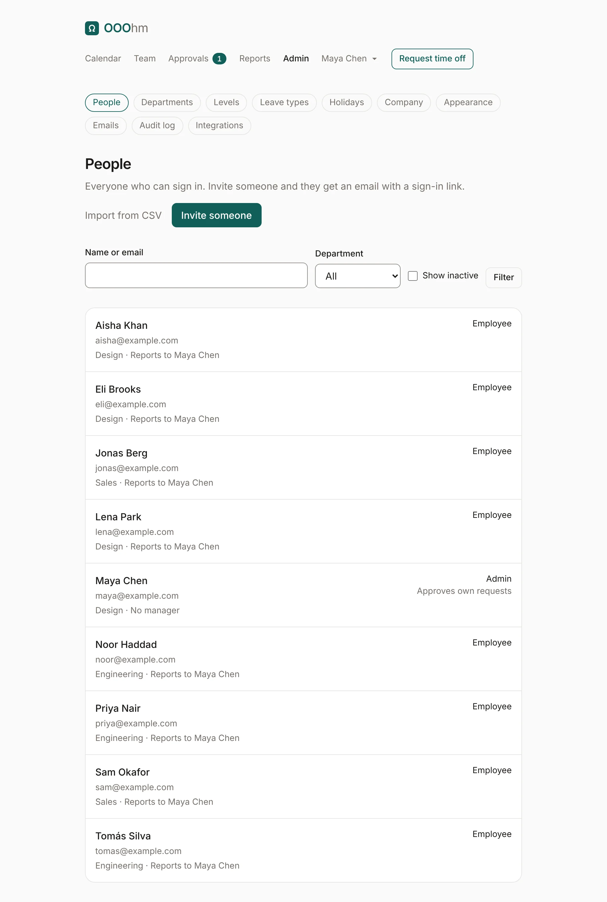
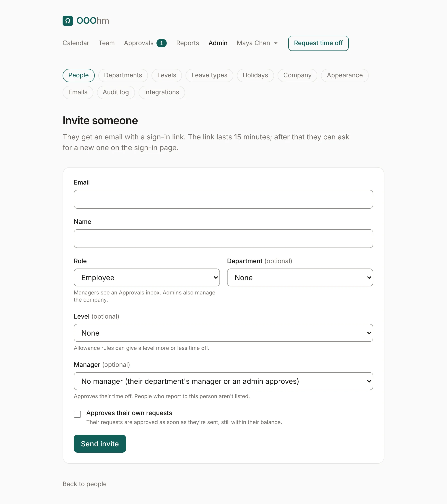
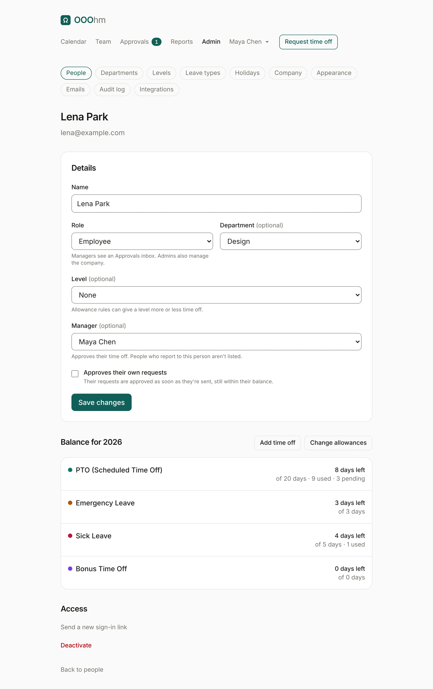
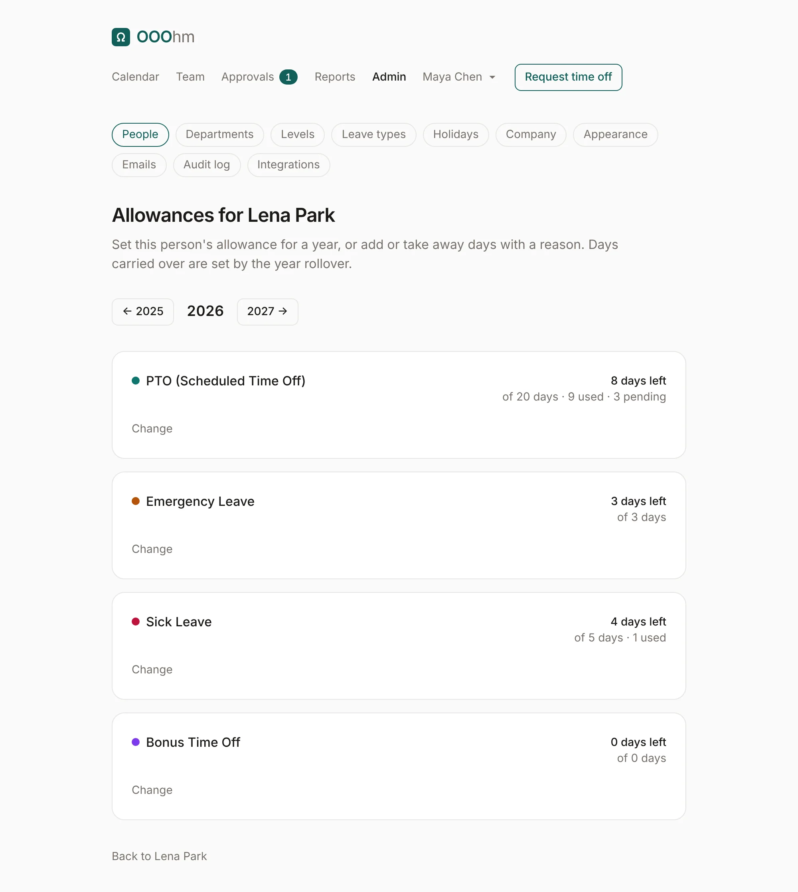
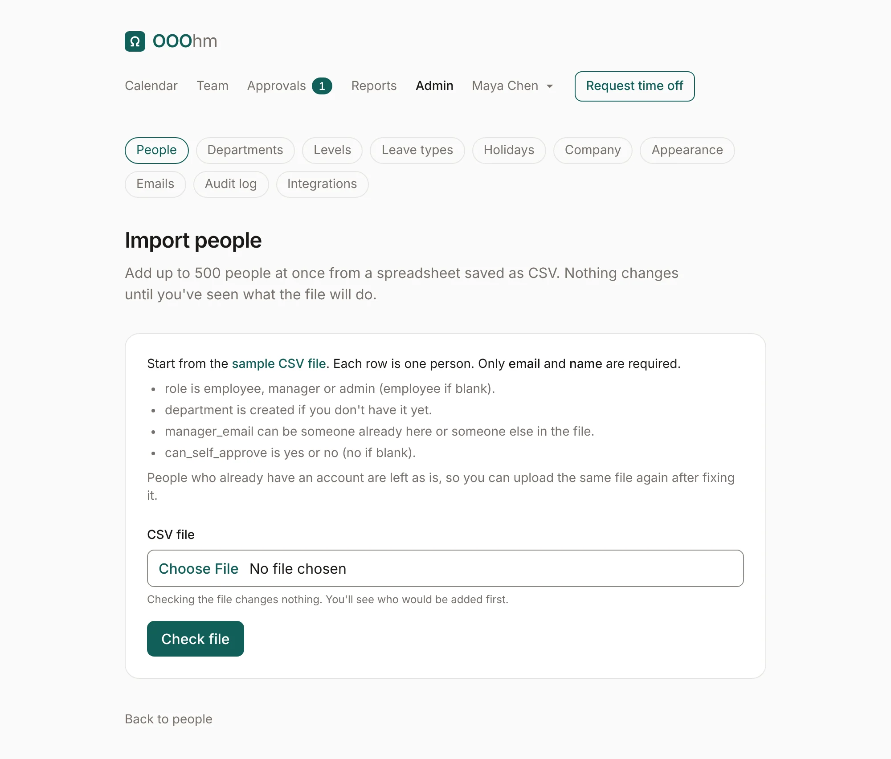
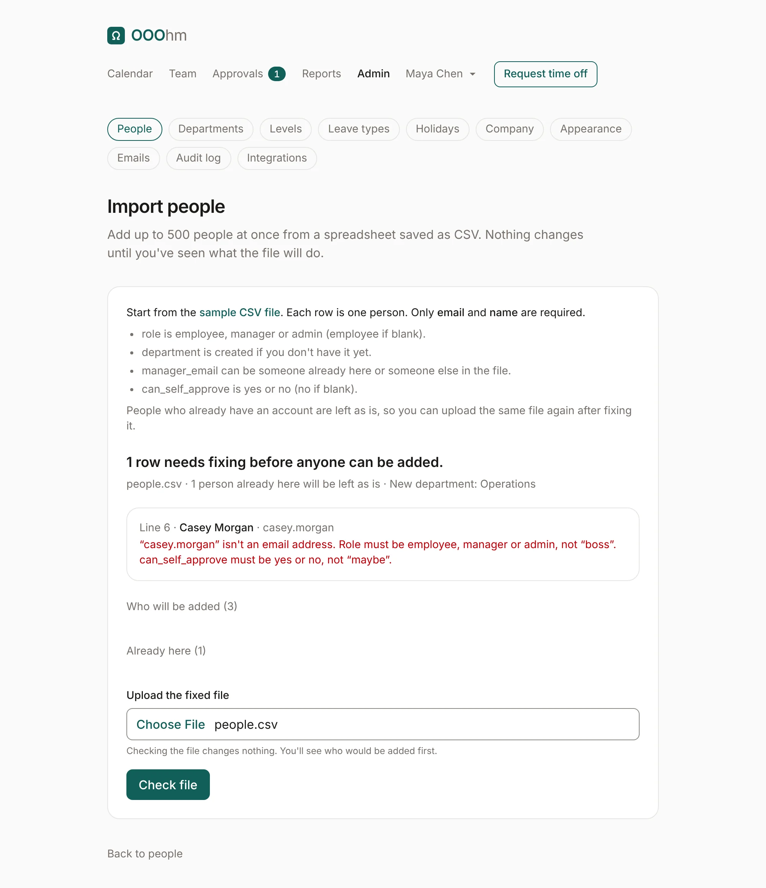
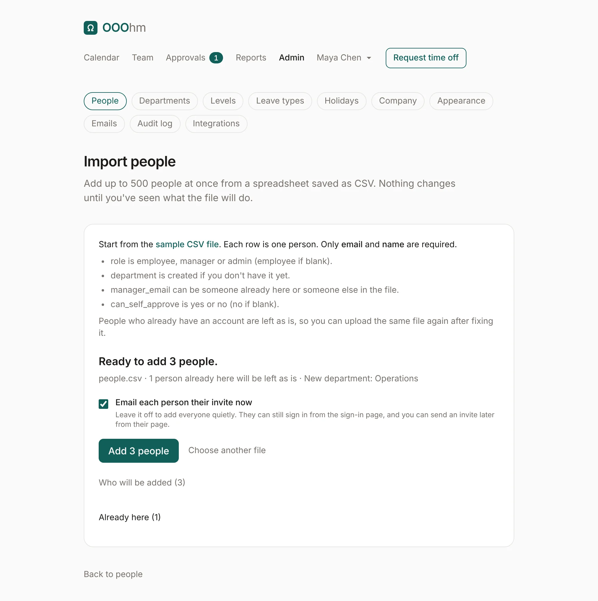

# People

Admin → **People** lists everyone who can sign in. Search by name or email, filter by department, and
tick **Show inactive** to include deactivated people. Each row shows their department, who they report
to, their role, and whether they approve their own requests.

## Inviting someone

**Invite someone** opens the invite form. The person gets an [invite email](emails.md#invite) with a
sign-in link. This is the only way people get in: signing in can't create an account.

| Field | What it does |
| --- | --- |
| **Email** | How they sign in. One account per address. |
| **Name** | How they appear to the team, on the calendar and in emails. |
| **Role** | Employee, Manager or Admin. Managers see an Approvals inbox and Reports; admins also manage the company. |
| **Department** | Optional. Used for the Who's out filter, reports, department managers, coverage limits, allowance rules and department scoping. |
| **Level** | Optional, and only shown once you have [levels](admin-organization.md#levels). Allowance rules can give a level more or less time off. |
| **Manager** | Approves their time off. With no manager, their department's manager approves, else an admin. People who report to this person aren't listed, so nobody ends up approving their own manager. |
| **Approves their own requests** | Their requests are approved as soon as they're sent, still within their balance. |

## A person's admin page

Open a name to change their details, see their balance for this year, and manage their access.

- **Add time off** opens their page under Team, with the [add time off](team.md#a-persons-page) form.
- **Change allowances** sets their own allowance for a year (see below).
- **Send a new sign-in link** emails them a fresh [invite](emails.md#invite).
- **Deactivate** signs them out and stops them signing in; their calendar links stop working too. Their
  requests stay. Requests waiting for their approval move to another approver. **Reactivate** undoes it.

### Allowances

**Change allowances** lists each leave type for a year, with what they get by default. **Change** sets
this person's own **Allowance for** that year, an **Adjustment** (days added on top, or taken away with
a minus), and a **Reason**, which is kept in the audit log. Leave types that don't count against an
allowance have nothing to set.

Where the default comes from: the leave type's yearly allowance, or an
[allowance rule](admin-organization.md#allowance-by-department-or-level) for their department or level.
A person's own allowance beats both.

### Deleting someone

Deleting takes two steps, so nobody is removed by accident: deactivate them first, then **Delete** shows
on their page. You choose how:

- **Remove everything**: nothing about them stays in OOOhm. Approvals they made on other people's leave
  stay, under "Former employee". If the company turned on the [7-day wait](admin-company.md), it's
  scheduled instead, and you can **Undo** it on their page or the People list until it runs.
- **Remove their account, keep their records**: their sign-in and email go; their leave, balances,
  approvals and audit entries stay under "Name (deleted)", and their email can be invited again as a
  new account.

The dialog lists exactly what goes and what stays, offers **Download their records first**, and asks
you to type their name to confirm. Someone who still has people reporting to them, or the only admin,
can't be deleted until that's sorted out; the dialog says what to do first.

## Importing people from a CSV

**Import from CSV** on the People page adds up to 500 people at once. Nothing changes until you've seen
what the file will do.

Start from the **sample CSV file** on the page. Each row is one person:

| Column | Required | Values |
| --- | --- | --- |
| `email` | Yes | Their work email. |
| `name` | Yes | Their name. |
| `role` | No | employee, manager or admin. Blank means employee. |
| `department` | No | Created if you don't have it yet. |
| `manager_email` | No | Someone already in OOOhm, or someone else in the same file. |
| `can_self_approve` | No | yes or no. Blank means no. |

**Check file** reads it and shows what would happen. If any row has a problem, nothing can be added
until it's fixed, and each problem names its line:

People who already have an account are left as is, so you can fix the file and upload it again. When
every row is fine, **Add N people** adds them all at once (all or nothing). Tick **Email each person
their invite now** to send invites; leave it off to add everyone quietly. They can still sign in from
the sign-in page, and you can send an invite later from their page.

