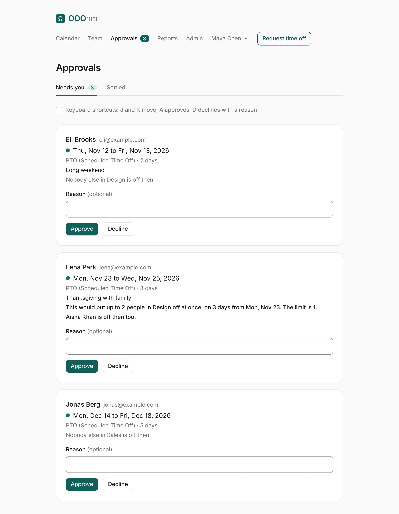
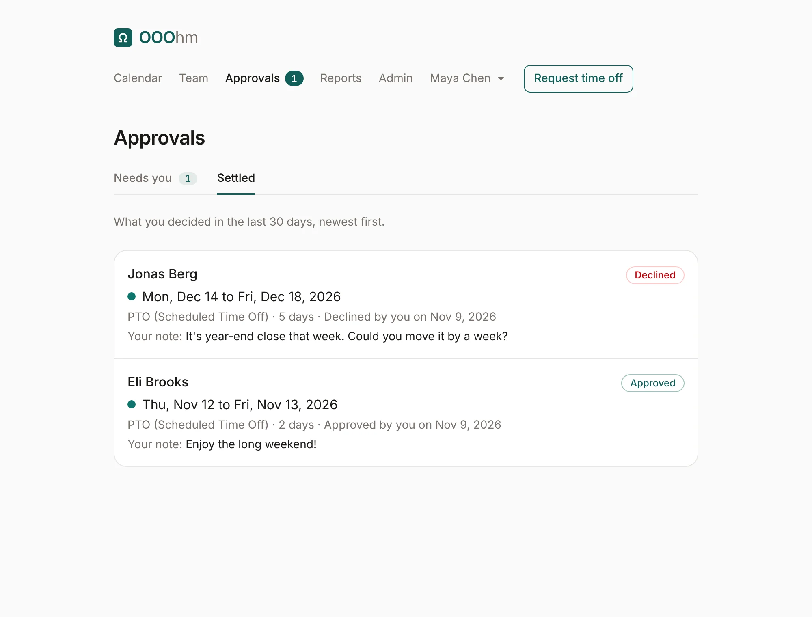
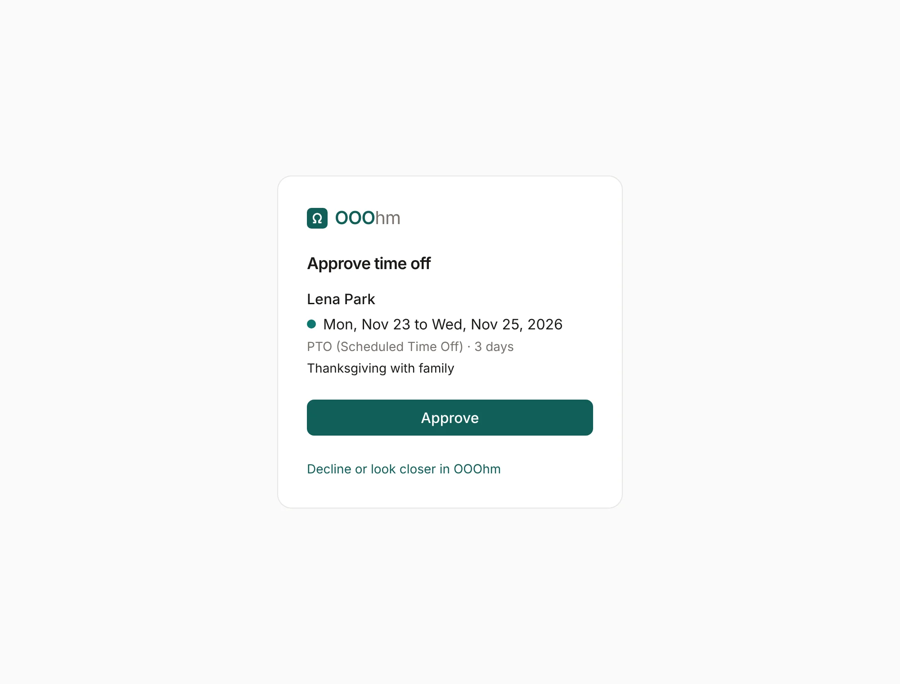

# Approvals

Managers and admins have **Approvals** in the top bar, with a count of what's waiting for them.

## Who approves whom

Each person has one approver:

1. their manager (Admin → People);
2. if they have none, their department's manager (Admin → Departments);
3. if there's none of those either, an admin.

Someone set to **Approves their own requests** has their requests approved as soon as they send them,
still within their balance. When a company turns approval off (**Just let us know** under
[Company](admin-company.md#time-off-approval)), nothing waits here: time off is booked straight away,
and the approver gets a [heads-up email](emails.md#heads-up) instead.

## Needs you

Each request shows who asked, the dates, the leave type, how many days, and their note. Under it,
OOOhm says who else is off then (*Aisha Khan is off then too*), or that nobody else in their
department is.

If the person's department has a [coverage limit](admin-organization.md#coverage-limits) and this
request would go past it, a warning says so in bold: *This would put up to 2 people in Design off at
once, on 3 days from Mon, Nov 23. The limit is 1.* It's a warning only; you can still approve.

**Approve** or **Decline**, with an optional **Reason**. The person gets an email either way
([approved](emails.md#approved), [declined](emails.md#declined)), with your reason in it.

**Keyboard shortcuts**: tick the box to use J and K to move between requests, A to approve, and D to
decline with a reason.

## Waiting on others

Admins also see **Waiting on others**: requests assigned to someone else. As an admin you can still
decide them.

## Settled

**Settled** lists what you decided in the last 30 days, newest first, with your note.

## Approving from the email

The [request email](emails.md#time-off-request) has an **Approve** button. It opens a page in OOOhm
that shows the request and asks once more, so a mail scanner that follows links can't approve
anything by itself.

The link is for that approver alone and works for 7 days. It stops working once the request is
decided, cancelled, or moves to another approver. To decline, use **Decline or look closer in OOOhm**.
