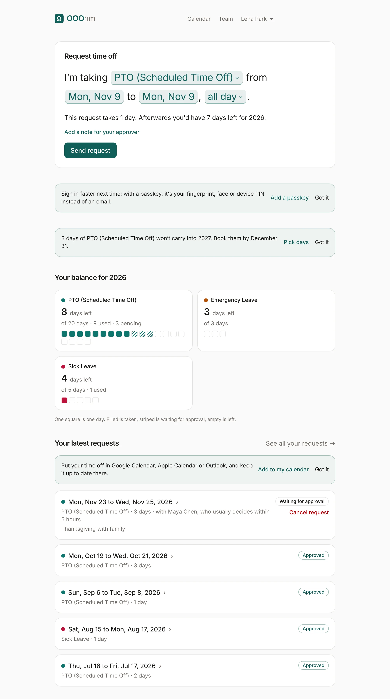
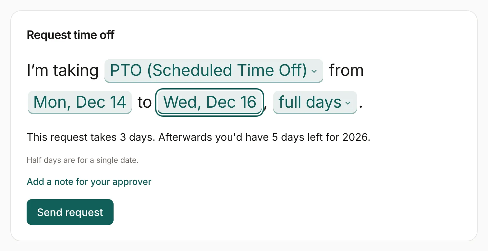
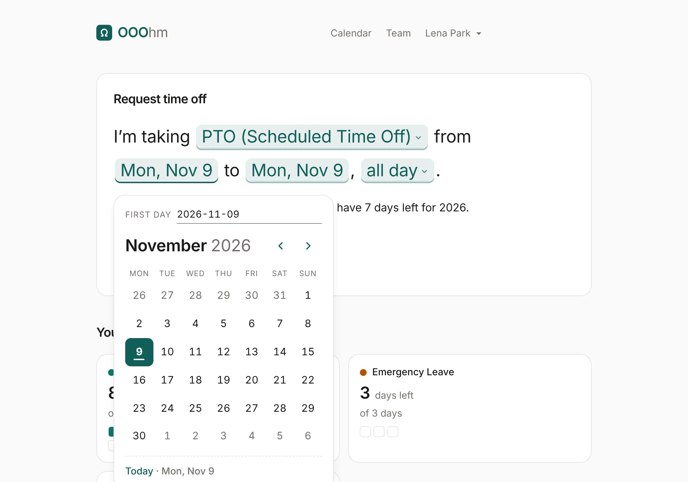
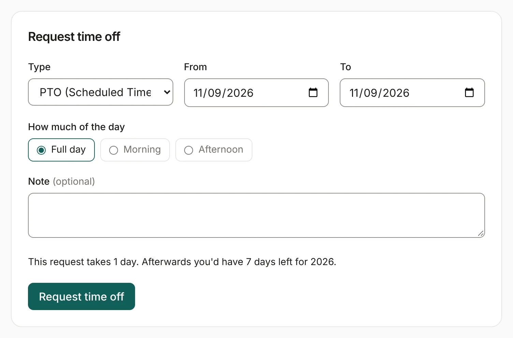
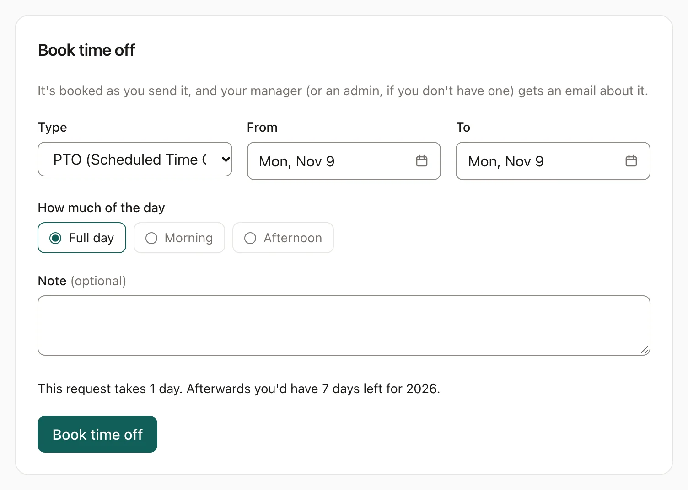
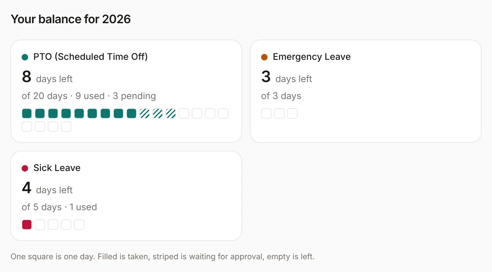
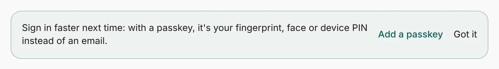
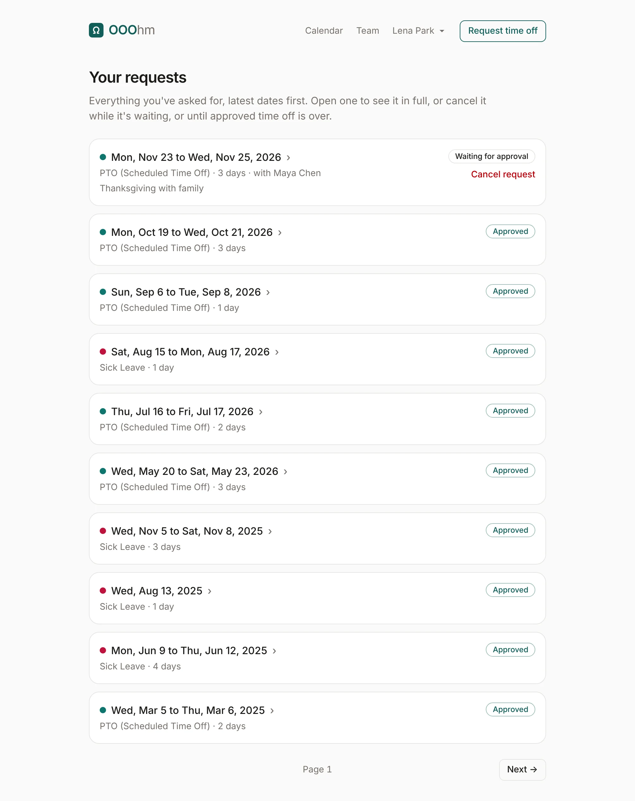
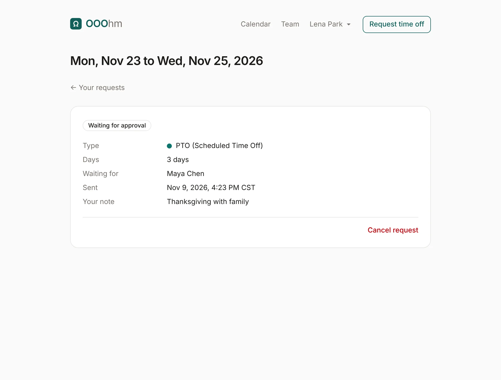

# Asking for time off

Home is where you ask for time off. It has one main action, the request, then your balance and your
latest requests.

## The request

Your company asks for time off in one of two styles. An admin picks it under
[Appearance](admin-appearance.md#how-people-ask-for-time-off); both send the same request and count
days the same way.

### The sentence

The request reads as one sentence with the choices inside it: *I'm taking PTO from Mon, Dec 14 to
Wed, Dec 16, full days.* Choose the leave type, the first day, the last day and how much of the day.

Each date opens a calendar. Pick a day, or type it as YYYY-MM-DD in the field at the top. The arrow
keys move between days and Enter picks one.

### The form

The form asks the same things as labelled fields: Type, From, To, How much of the day (Full day,
Morning or Afternoon) and an optional Note. From and To open the same calendar as the sentence.

### What the request tells you before you send it

As you choose, a line under the request says what it would cost: *This request takes 3 days.
Afterwards you'd have 5 days left for 2026.* Weekends, other non-working days and company holidays
never count. If the request can't be sent (it overlaps time off you already have, or it would take
more than you have left), the line says why, in red.

- **Half days** (Morning or Afternoon) are for a single date and count as 0.5.
- **Add a note for your approver** opens a box for a short note. Your approver sees it in their
  inbox and in the [request email](emails.md#time-off-request).
- If your department has a [coverage limit](admin-organization.md#coverage-limits) and too many people
  would be off at once, you see a warning. It doesn't stop you sending.

**Send request** sends it to your approver: your manager, else your department's manager, else an
admin. They get an email, and the request shows as *Waiting for approval* until they decide. If you
approve your own requests (an admin sets this per person), it's approved as soon as you send it.

### When your company doesn't ask for approval

If an admin set approval to **Just let us know** (Admin → Company), the request becomes
**Book time off**: it's booked as soon as you send it, and your manager (or an admin) gets a
[heads-up email](emails.md#heads-up) instead of a request.

## Your balance

Under the request, a card for each leave type shows what you have left this year, out of how many,
and how many are used or waiting for approval. One square is one day: filled is taken, striped is
waiting for approval, empty is left.

## Notes on Home

A few quiet notes show on Home when they apply. **Got it** hides one in this browser for good.

- **Add a passkey**, until you have one.
- **Days that won't carry over**: from November 1, the days of your main leave type (the first one
  in the list, usually vacation) that won't carry into next year, with **Pick days** to open the
  calendar. Sick days never get this note.
- **Add to my calendar**, once you have approved time off and no calendar subscription yet.

## Your requests

**See all your requests** opens every request you've made, latest dates first, a page at a time.

Each request has a status: *Waiting for approval*, *Approved*, *Declined* or *Cancelled*. A waiting
request also says who it's with and how quickly they usually decide (*with Maya Chen, who usually
decides within 5 hours*). Open one to
see it in full: the type, the days, who it's waiting for (or who decided it and when), your note and
any reason they gave.

### Cancelling

**Cancel request** works while a request is waiting, and on approved time off until it's over. The
request isn't cancelled straight away: you get 20 seconds to **Undo**. Once it goes through, the days
are back in your balance, and you and your approver each get an email
([to you](emails.md#cancelled-to-the-person), [to the approver](emails.md#cancelled-to-the-approver)).
Time off that's already over can't be cancelled; a manager or admin can remove it to correct the
record (see [Who's out](team.md#a-persons-page)).
