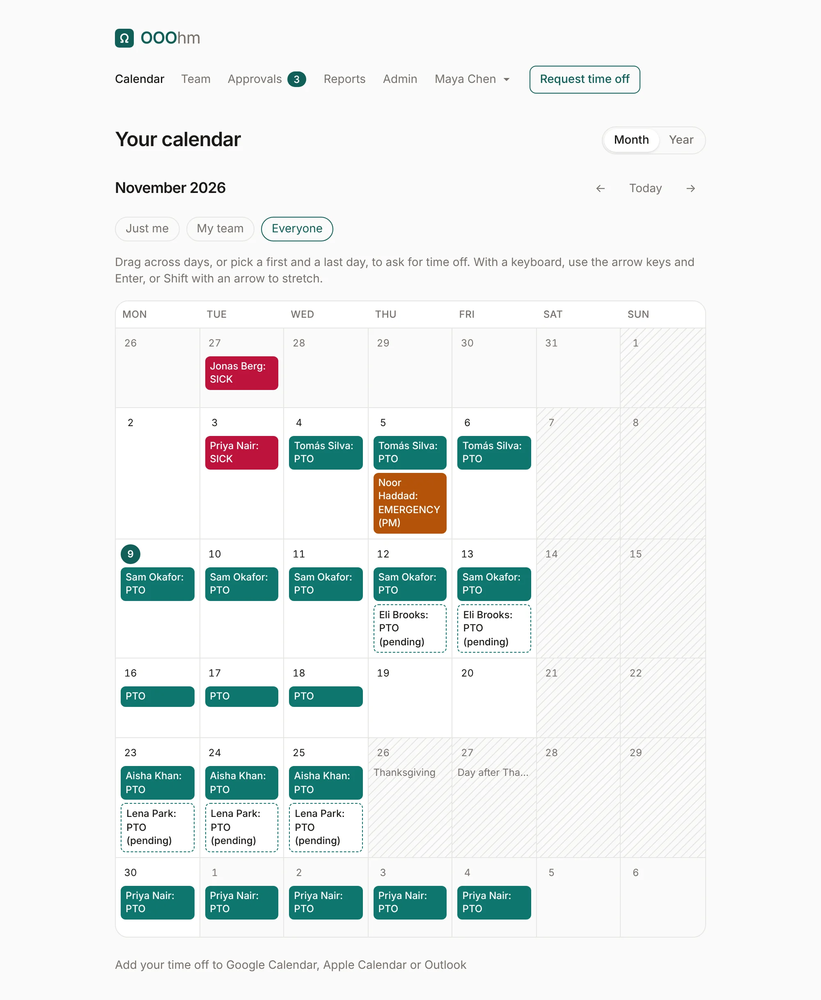
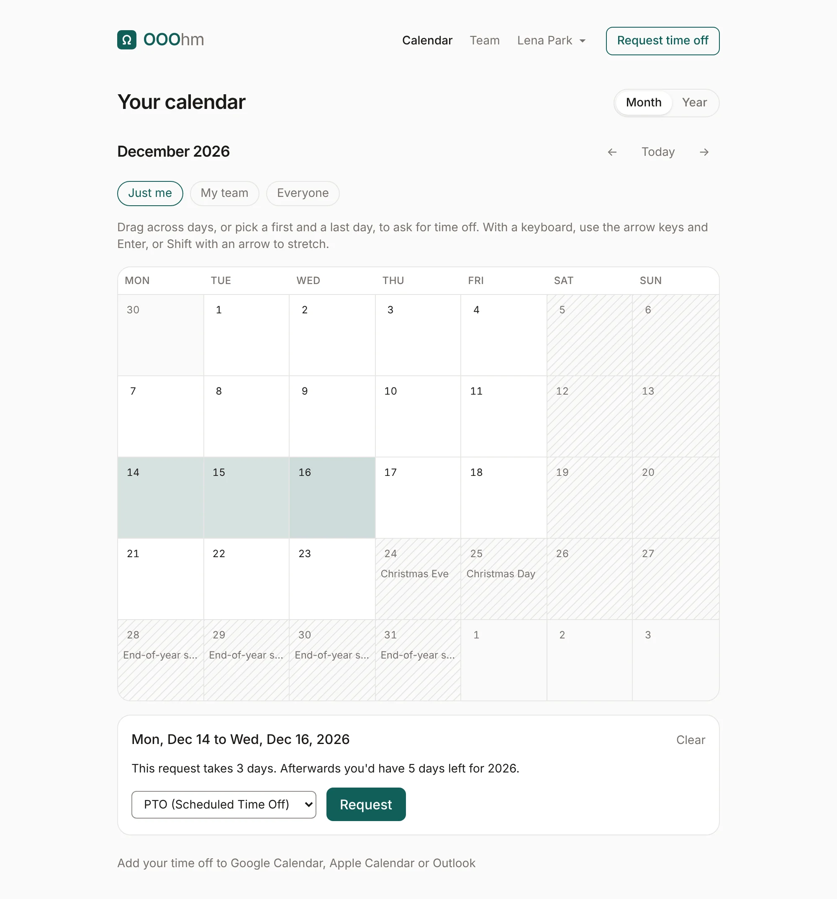
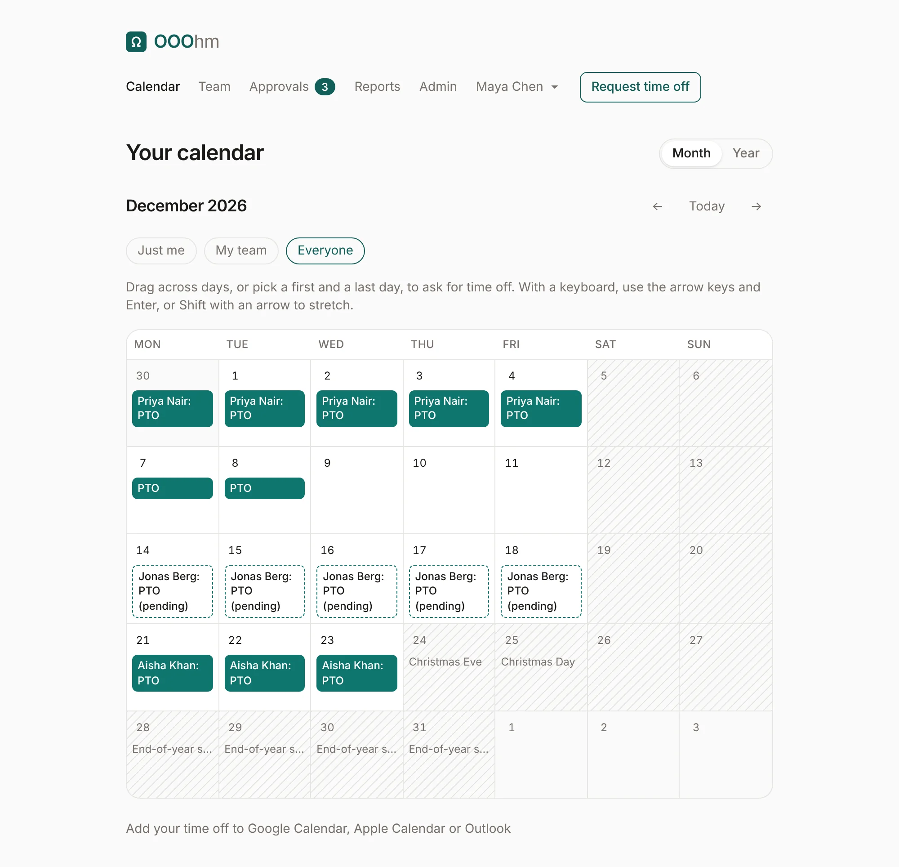
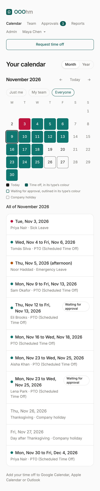
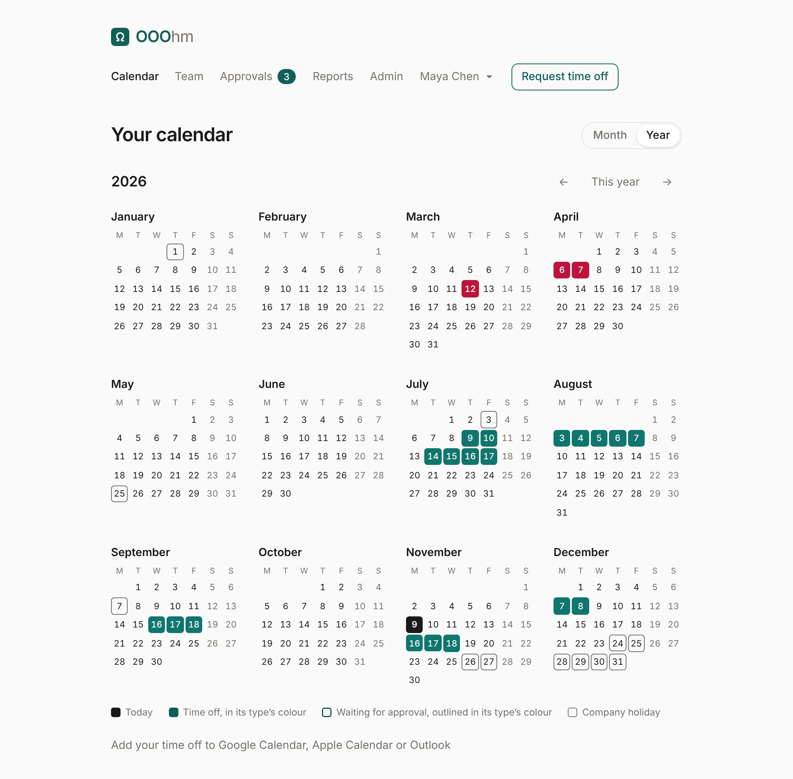
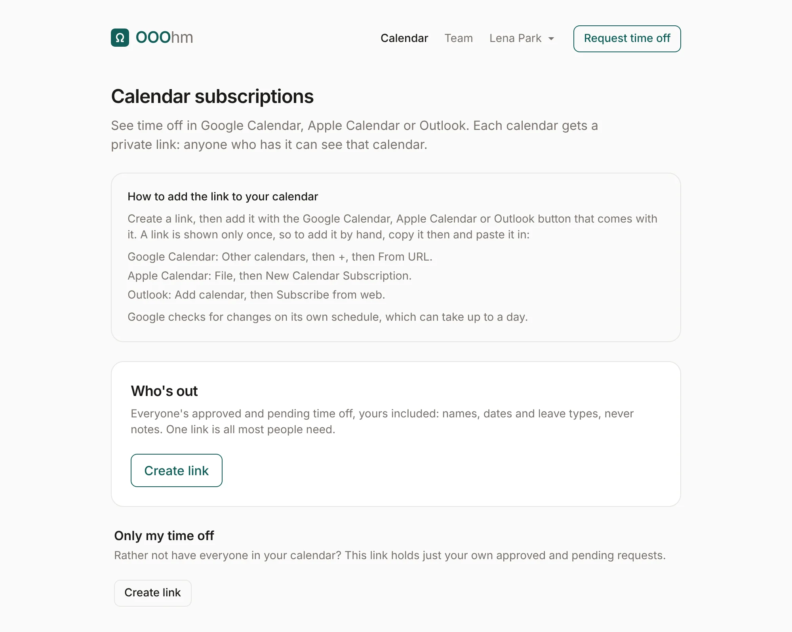

# Calendar

**Calendar** in the top bar shows time off on a calendar. **Month** and **Year** switch the view; the
arrows move a month or a year, and **Today** (or **This year**) comes back.

## Month

Each day shows the time off on it as a chip in its leave type's colour, with the person's name and
the type's short code (your own show the code alone). Time off waiting for approval has a dashed
outline and says *pending*; a half day says *AM* or *PM*. Weekends and other non-working days are shaded, and company
holidays are shaded with their name.

### Whose time off

The pills above the month choose whose time off it shows:

- **Just me**: only yours.
- **My team**: you, your manager, the others who report to your manager, and anyone who reports to you.
- **Everyone**: everyone you're allowed to see.

What "everyone" means is set by an admin under [Company](admin-company.md#who-sees-whose-time-off):
everyone in the company, only your team, or only your own. When it's only your own, the pills don't
show. Admins always see everyone.

### Asking for days on the calendar

Drag across days, or click a first and a last day, to ask for that time off. A panel under the month
shows the dates, what the request would take and leave, a leave type, and **Request**. **Clear** starts
over. With a keyboard, use the arrow keys and Enter, or Shift with an arrow to stretch.

Holidays show on the month too. Here an end-of-year shutdown (see [Holidays](admin-holidays.md))
covers December 28 to 31:

On a phone, the month becomes a compact grid: days with time off are filled in their type's colour,
and everything in the month is listed under it.

## Year

The year view shows your own time off across twelve months: filled in its type's colour when approved,
outlined while waiting, with today and company holidays marked.

## Calendar subscriptions

**Add your time off to Google Calendar, Apple Calendar or Outlook**, under the calendar (or on your
account page), opens Calendar subscriptions. Each calendar gets a private link: anyone who has the
link can see that calendar, so treat it like a password.

| Calendar | What it holds |
| --- | --- |
| **Who's out** | The approved and pending time off of everyone you can see, yours included: names, dates and leave types, never notes. |
| **Only my time off** | Just your own approved and pending requests. |

**Create link** makes the link and shows it once, with buttons for Google Calendar, Apple Calendar
and Outlook. To add it by hand, copy it then:

- Google Calendar: Other calendars, then +, then From URL.
- Apple Calendar: File, then New Calendar Subscription.
- Outlook: Add calendar, then Subscribe from web.

Once a link exists, **Lost it? Replace the link** makes a new one (the old one stops working, and
calendars using it stop updating), and **Turn off** switches it off. Google Calendar adds a
subscription on a computer only, not in its phone app, and checks for changes on
its own schedule, which can take up to a day. When someone is deactivated, their links stop working.
