# Emails

OOOhm sends an email for every change someone should hear about, and nothing else: no digests, no
reminders, no marketing. Every email has a plain-text version and an HTML version in your company's
accent colour, with your logo at the top if you've uploaded one (see [Appearance](admin-appearance.md)).

The examples below use OOOhm's own wording and the made-up names the email editor's preview uses
(Ana Ruiz asks, Mo Reyes approves, at a company called Acme).

## At a glance

| Email | Who gets it | When |
| --- | --- | --- |
| [Time off request](#time-off-request) | The approver | Someone asks for time off. |
| [Approved](#approved) | The person | Their time off is approved. |
| [Declined](#declined) | The person | Their request is declined. |
| [Booked](#booked) | The person | They book time off and approval is turned off. |
| [Heads-up](#heads-up) | Their manager (or an admin) | Someone books time off and approval is turned off. |
| [Added for someone](#added-for-someone) | The person | A manager or admin adds time off for them. |
| [Removed for someone](#removed-for-someone) | The person | A manager or admin removes their time off to correct the record. |
| [Cancelled (to the person)](#cancelled-to-the-person) | The person | They cancel their time off. |
| [Cancelled (to the approver)](#cancelled-to-the-approver) | The approver | Someone cancels time off. |
| [Recounted](#recounted) | The person | A holiday or working-day change alters what their time off takes. |
| [Invite](#invite) | The new person | An admin adds them, or sends a new sign-in link. |
| [Sign-in link](#sign-in-link) | Anyone with an account | They ask for a link on the sign-in page. |

Every email but the sign-in link can be reworded under Admin → Emails.

## Changing what an email says

Admin → **Emails** lists every email, who gets it, and whether it uses *OOOhm's wording* or *Your
wording*.

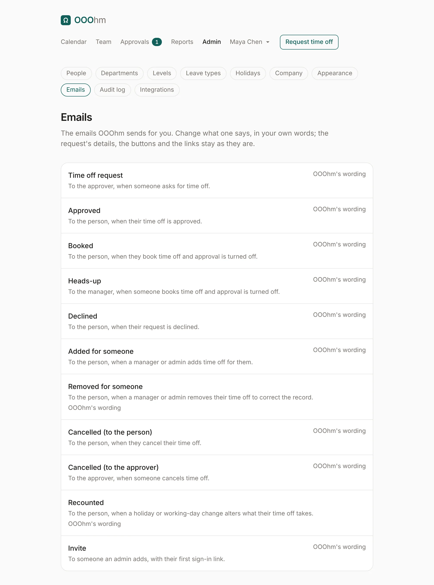

Open one to change its **Subject** and **Message**. The preview on the right updates as you type, with
made-up names and dates, in your accent colour.

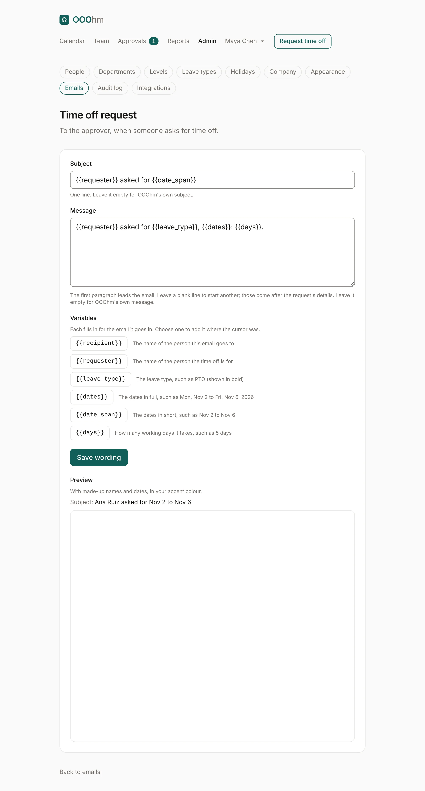

- **Subject** is one line. Leave it empty for OOOhm's own subject.
- **Message**: the first paragraph leads the email. Leave a blank line to start another paragraph;
  those come after the request's details. Leave it empty for OOOhm's own message.
- **Variables** like `{{requester}}` fill in for each email. Choose one under the message to add it
  where the cursor was. If a variable fills in to nothing in the subject, OOOhm's own subject is used,
  so no email goes out without one.
- **Save wording** applies to every email of that kind from then on. Once saved, **Go back to
  OOOhm's wording** (under the editor) puts the default back. Both are recorded in the audit log.

What you can't change, on purpose: the request's details (dates, note, who else is off, the reason),
the buttons, the links, and the footer. Notes and reasons people type are never variables; they appear
in the body only, escaped, so nothing typed can change an email's subject or headers.

### Variables in every time off email

| Variable | Fills in |
| --- | --- |
| `{{recipient}}` | The name of the person this email goes to. |
| `{{requester}}` | The name of the person the time off is for. |
| `{{leave_type}}` | The leave type, such as PTO (shown in bold). |
| `{{dates}}` | The dates in full, such as Mon, Nov 2 to Fri, Nov 6, 2026. |
| `{{date_span}}` | The dates in short, such as Nov 2 to Nov 6. |
| `{{days}}` | How many working days it takes, such as 5 days. |

Some emails add their own; they're listed with each email below.

## Time off request

**To** the approver, **when** someone asks for time off.

| | Default |
| --- | --- |
| Subject | `{{requester}} asked for {{date_span}}` |
| Message | `{{requester}} asked for {{leave_type}}, {{dates}}: {{days}}.` |

Adds on its own: the requester's note in quotes, and who else is off then. **Approve** opens the
[approve page](approvals.md#approving-from-the-email); **Open in OOOhm** opens the inbox. The footer
says the Approve link is for this approver alone and stops working once the request is decided.

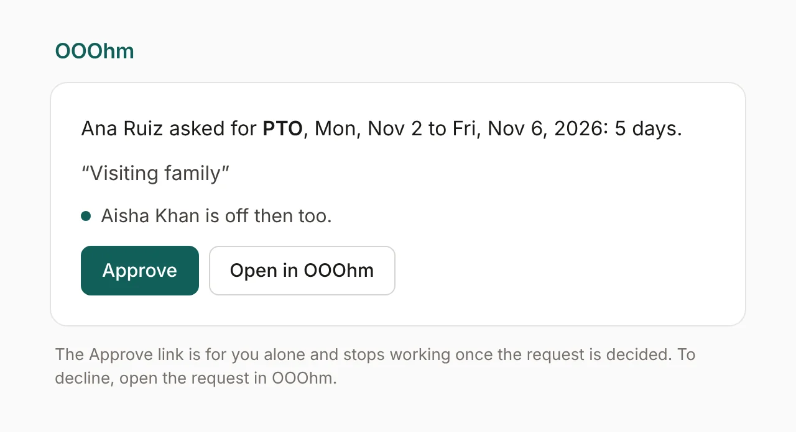

```text
Subject: Ana Ruiz asked for Nov 2 to Nov 6

Ana Ruiz asked for PTO, Mon, Nov 2 to Fri, Nov 6, 2026: 5 days.

“Visiting family”

Aisha Khan is off then too.

Approve: https://ooohm.example/approve/…
Decline or look closer in OOOhm: https://ooohm.example/

The Approve link is for you alone and stops working once the request is decided. To decline, open the request in OOOhm.
```

## Approved

**To** the person, **when** their time off is approved (in the inbox, from the email, or by the
approver deciding it in OOOhm).

| | Default |
| --- | --- |
| Subject | `Your time off is approved` |
| Message | `Your {{leave_type}} is approved, {{dates}}: {{days}}.` |

Adds on its own: the approver's reason, as *Note from approver*, when they gave one.

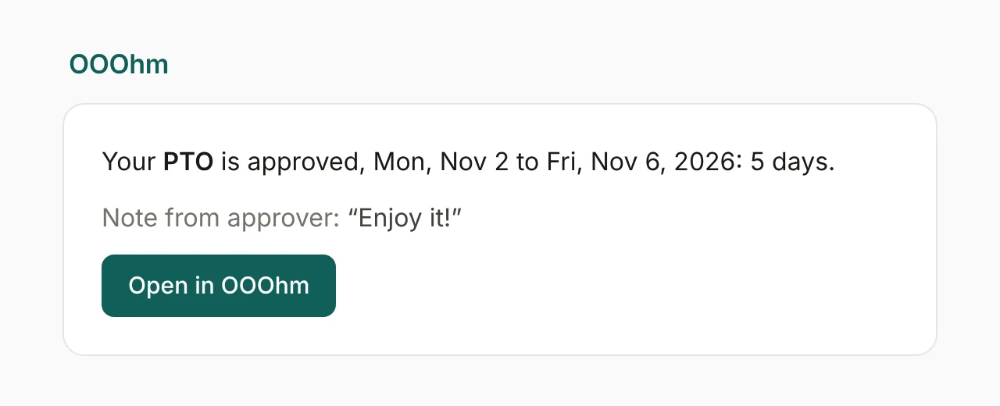

## Declined

**To** the person, **when** their request is declined.

| | Default |
| --- | --- |
| Subject | `Your time off request was declined` |
| Message | `Your {{leave_type}} request was declined, {{dates}}: {{days}}.` |

Adds on its own: the approver's *Reason*, when they gave one.

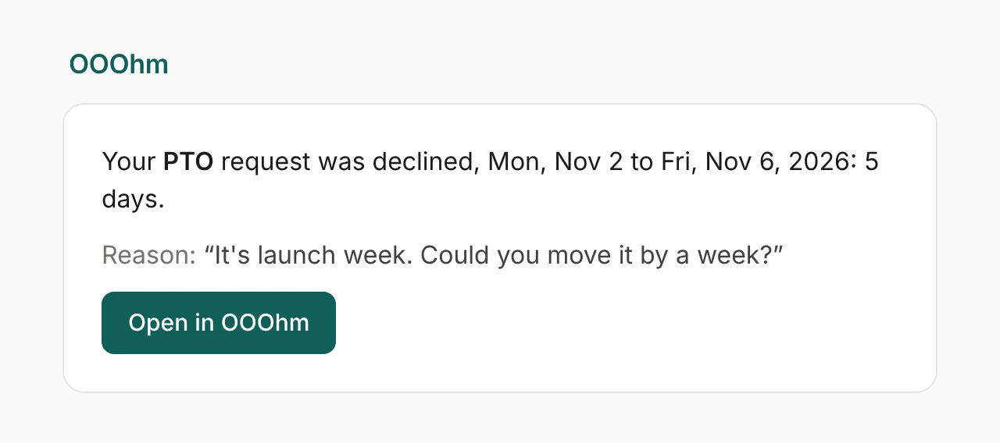

## Booked

**To** the person, **when** they book time off and the company's approval is set to **Just let us
know**.

| | Default |
| --- | --- |
| Subject | `Your time off is booked` |
| Message | `Your {{leave_type}} is booked, {{dates}}: {{days}}. Enjoy it.` |

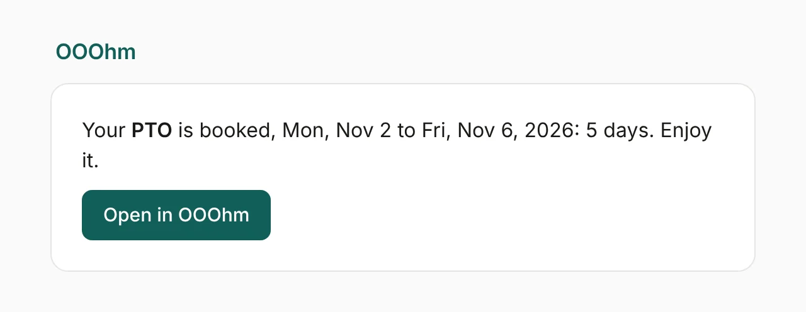

## Heads-up

**To** the person's manager, or an admin when they have none, **when** someone books time off and
approval is turned off. Nothing to approve: it tells them.

| | Default |
| --- | --- |
| Subject | `{{requester}} is off {{date_span}}` |
| Message | `{{requester}} is taking {{leave_type}}, {{dates}}: {{days}}. It's booked, so there's nothing you need to do.` |

Adds on its own: the note, and who else is off then.

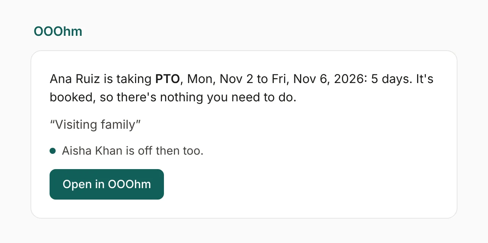

## Added for someone

**To** the person, **when** a manager or admin adds time off for them (on their page under Team). It's
approved as it's added.

| | Default |
| --- | --- |
| Subject | `Time off was added for you` |
| Message | `{{added_by}} added your {{leave_type}}, {{dates}}: {{days}}. It's approved, so there's nothing you need to do.` |

Extra variable: `{{added_by}}`, the manager or admin who added it. Adds on its own: their *Note*, if any.

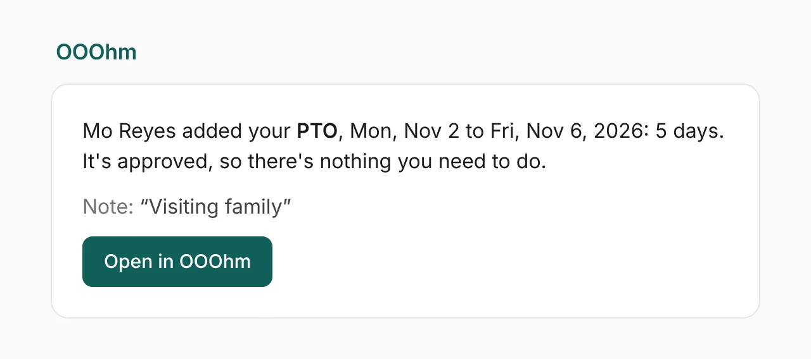

## Removed for someone

**To** the person, **when** a manager or admin removes their approved time off to correct the record.

| | Default |
| --- | --- |
| Subject | `Time off was removed for you` |
| Message | `{{removed_by}} removed your {{leave_type}}, {{dates}}: {{days}}. Those days are back in your balance.` |

Extra variable: `{{removed_by}}`. Adds on its own: the *Reason*, which is required.

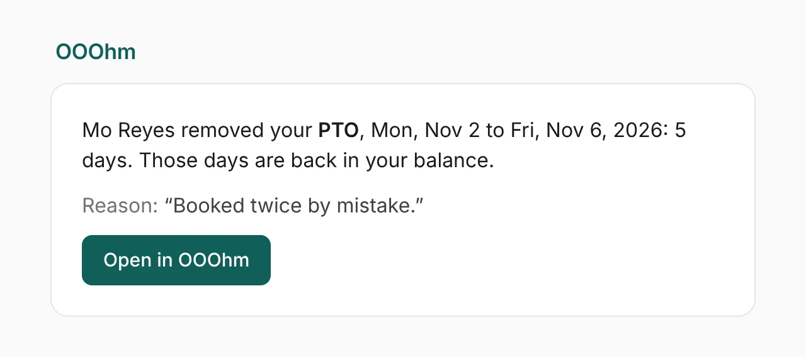

## Cancelled (to the person)

**To** the person, **when** they cancel their own time off (after the 20-second undo has passed).

| | Default |
| --- | --- |
| Subject | `Your time off request was cancelled` |
| Message | `Your {{leave_type}} request was cancelled, {{dates}}: {{days}}.` |

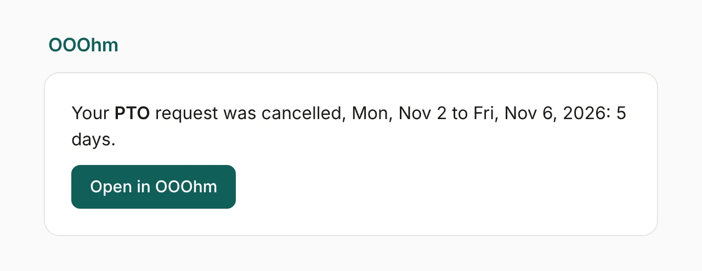

## Cancelled (to the approver)

**To** the approver, **when** someone cancels time off.

| | Default |
| --- | --- |
| Subject | `A time off request was cancelled` |
| Message | `{{requester}} cancelled their {{leave_type}}, {{dates}}: {{days}}. Nothing else is needed from you.` |

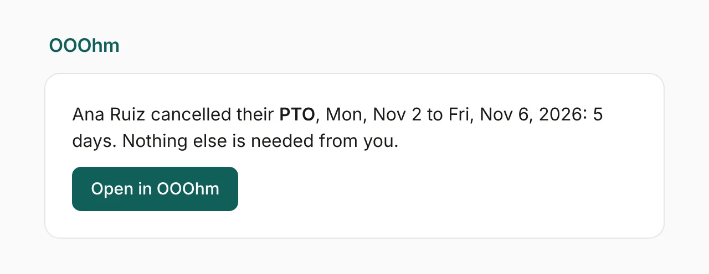

## Recounted

**To** the person, **when** an admin adds or deletes a holiday, or changes the working days, and that
changes how many days their time off takes (this year and later).

| | Default |
| --- | --- |
| Subject | `Your time off was recounted` |
| Message | `{{cause}}, so your {{leave_type}} for {{dates}} {{change}}.` |

| Extra variable | Fills in |
| --- | --- |
| `{{cause}}` | What changed, such as *Tue, Nov 3, 2026 is now a company holiday (Founders' Day)*. |
| `{{change}}` | What that does, such as *now takes 4 days instead of 5 days*. If it no longer takes any days, it says so and suggests cancelling it. |
| `{{previous_days}}` | How many days it took before, such as 5 days. |

Adds on its own: a *Balance* line when the new count leaves the person over their balance.


## Invite

**To** someone an admin adds (one at a time, or from a [CSV import](admin-people.md#importing-people-from-a-csv)
with *Email each person their invite now* ticked), and again when an admin chooses **Send a new
sign-in link** on their page.

| | Default |
| --- | --- |
| Subject | `You're invited to OOOhm` |
| Message | `{{inviter}} added you to {{company}} on OOOhm, where you ask for time off and see who's out.` |

| Variable | Fills in |
| --- | --- |
| `{{recipient}}` | The invited person's name. |
| `{{inviter}}` | The admin who invited them. |
| `{{company}}` | Your company's name. |

Fixed: the greeting (*Hi Ana Ruiz,*), the **Sign in to OOOhm** button with a one-time link, and the
footer: the link works once, expires in 15 minutes, and where to get a new one.

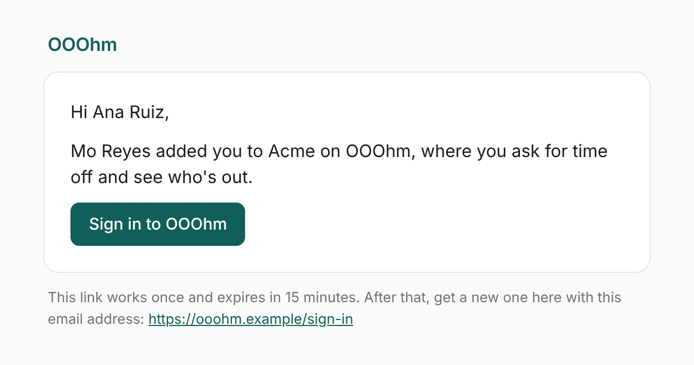

## Sign-in link

**To** anyone with an account who asks for a sign-in link on the sign-in page. Nothing anyone typed
appears in it, and it can't be reworded.

Subject: `Your OOOhm sign-in link`. The link works once and expires in 15 minutes; if they didn't ask
for it, they can ignore it. An address without an active account gets no email, and the sign-in page answers the same either
way, so it can't be used to find out who works there.

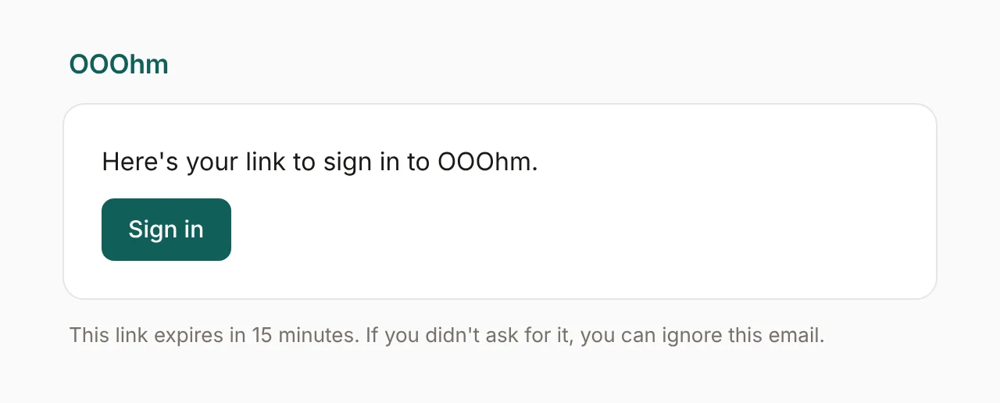

## Sending

Emails go out after the change is saved, never before, so a failed email never undoes a change. A
failed send is logged with the request or person it was about. How OOOhm sends mail (SMTP or the
SendGrid API, and the From address) is set by whoever runs it: see [hosting](../hosting.md).
