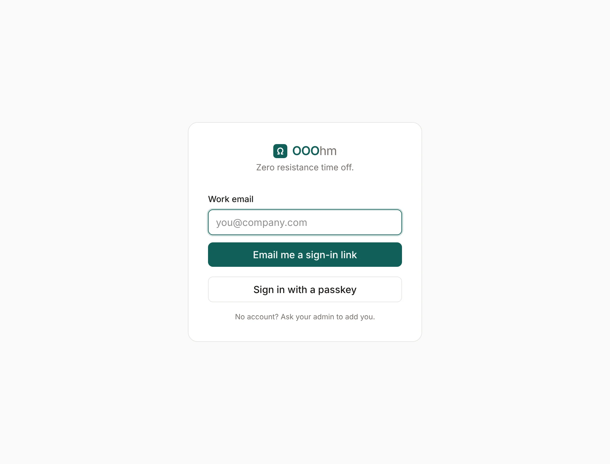
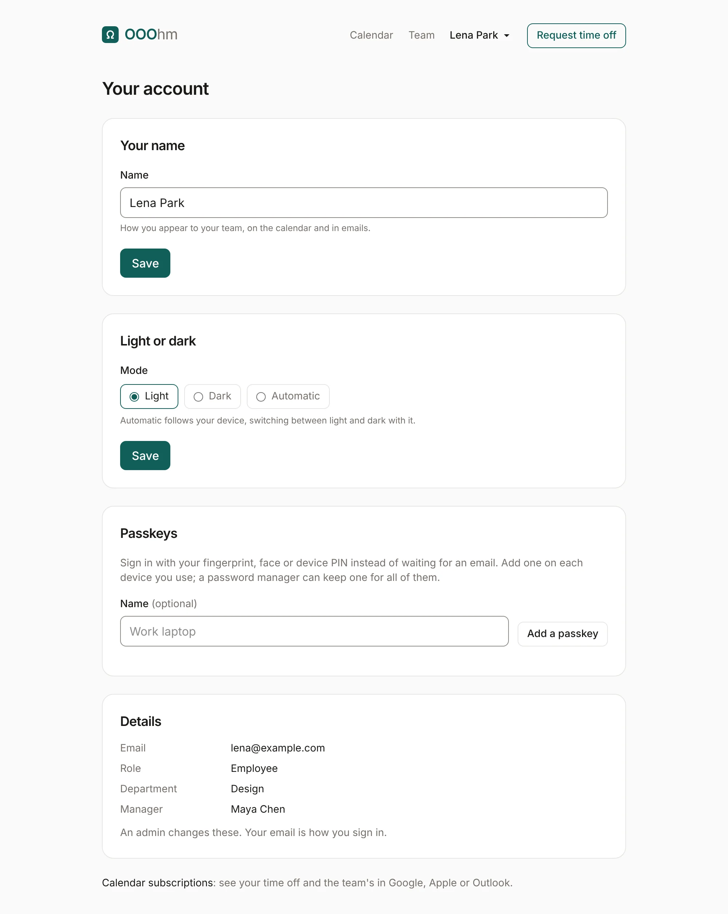
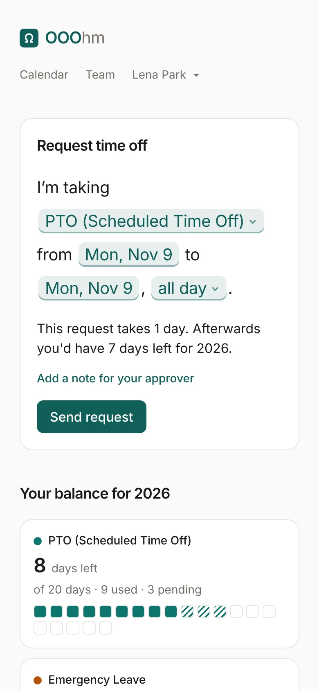

# Getting started

## Signing in

OOOhm is invite-only. An admin adds you, and you get an [invite email](emails.md#invite) with a
sign-in link. After that, sign in from the sign-in page: give your work email and OOOhm emails you a
[sign-in link](emails.md#sign-in-link). Each link works once and expires in 15 minutes.

Once you have a passkey, **Sign in with a passkey** skips the email. If your company turned on
Google sign-in, a **Continue with Google** button shows here too. Neither
an email link nor Google can create an account: if nobody has invited your address, you can't get in.

### Passkeys

A passkey signs you in with your fingerprint, face or device PIN instead of an email. Add one on
your account page (Home shows a reminder until you have one). Add one on each device you use, or
keep one in a password manager that syncs.

## Your account

Open your name in the top bar, then **Your account**.

| Setting | What it does |
| --- | --- |
| **Your name** | How you appear to your team, on the calendar and in emails. |
| **Light or dark** | Light, Dark, or Automatic (follows your device). It applies where your company's theme has a dark version; today that's Classic. |
| **Passkeys** | Add a passkey, with an optional name like "Work laptop", or remove one. |
| **Details** | Your email, role, department and manager. Only an admin can change these; your email is how you sign in. |

At the bottom, **Calendar subscriptions** puts time off in Google Calendar, Apple Calendar or
Outlook (see [Calendar](calendar.md#calendar-subscriptions)).

## On a phone

Every screen works on a phone. The top bar stays short, and the request sentence wraps to fit.

## First-time setup (admins)

A new install gets its first company and admin in one of two ways: the seed (`SEED_ADMIN_EMAIL` when
the app starts), or the **/setup** page in the browser when `SETUP_TOKEN` is set. The setup page only
works on an empty install and closes for good once used. See [hosting](../hosting.md).
