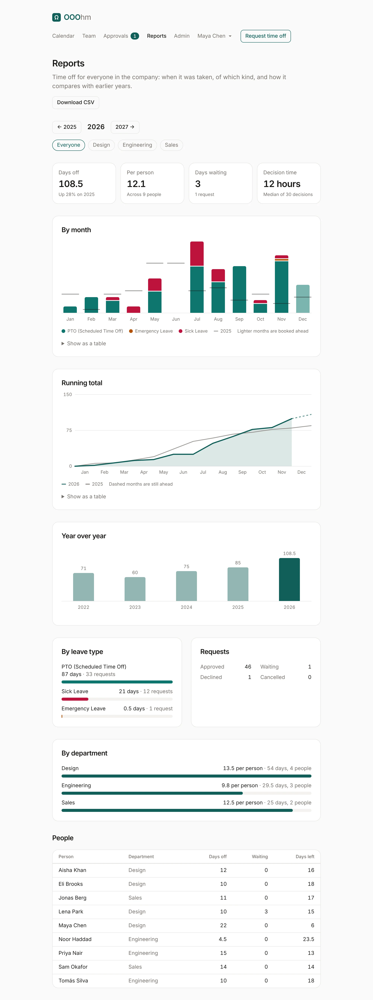

# Reports

**Reports** is for admins and managers. Admins see everyone in the company; a manager sees the people
who report to them. Pick a year with the arrows and narrow it to one department with the pills.
**Download CSV** saves the same numbers as a spreadsheet.

| Part | What it shows |
| --- | --- |
| **Days off** | Days of time off in the year, and the change on the year before. |
| **Per person** | The average across the people in the report. |
| **Days waiting** | Days in requests still waiting for approval, and how many requests. |
| **Decision time** | The median time from a request to its decision. |
| **By month** | Days off each month, stacked by leave type, with a line for the same month last year. Months still ahead are lighter: that's time off already booked. |
| **Running total** | Days off so far this year against last year. The dashed part is booked time off still ahead. |
| **Year over year** | Each year's total, this year highlighted. |
| **By leave type** | Days and requests per leave type. |
| **Requests** | How many were approved, declined, are waiting, or were cancelled. |
| **By department** | Days per person in each department. |
| **People** | Each person's days off, days waiting, and days left. |

Each chart has **Show as a table** for the numbers behind it, which also works with a screen reader.
