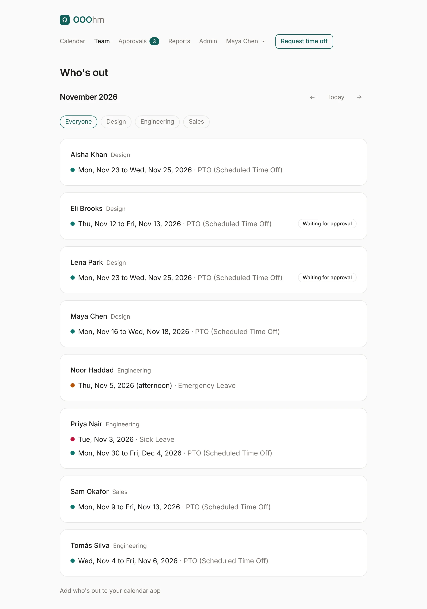
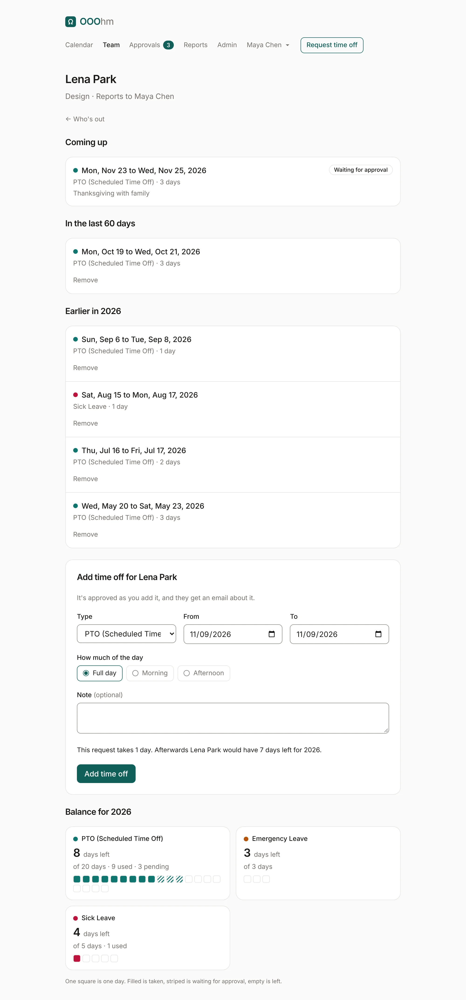

# Who's out

**Team** in the top bar lists who's out in a month: each person, their department, and their time off
that month. Time off still waiting for approval says so. The pills filter by department, and the
arrows move a month.

You see the people your company lets you see (see [Company](admin-company.md#who-sees-whose-time-off)).
**Add who's out to your calendar app** at the bottom opens [calendar subscriptions](calendar.md#calendar-subscriptions).

## A person's page

Open a name to see their page: their department and manager, what's coming up, what they took in the
last 60 days, and earlier this year.

Their manager and admins see more:

| Part | Who sees it |
| --- | --- |
| **Notes on requests** and the **Balance** | The person's manager (or department manager) and admins. An admin can turn this off for managers under [Company](admin-company.md). |
| **Add time off for …** | The person's manager and admins. It's approved as it's added, and the person gets an [email](emails.md#added-for-someone). |
| **Remove** on approved time off | The person's manager and admins, to correct the record (for example, booked twice by mistake). It needs a reason, which the person gets by [email](emails.md#removed-for-someone), and the days go back into their balance. |

Adding time off for someone uses the request form, with the same preview of what it takes and leaves:
*This request takes 1 day. Afterwards Lena Park would have 7 days left for 2026.*
